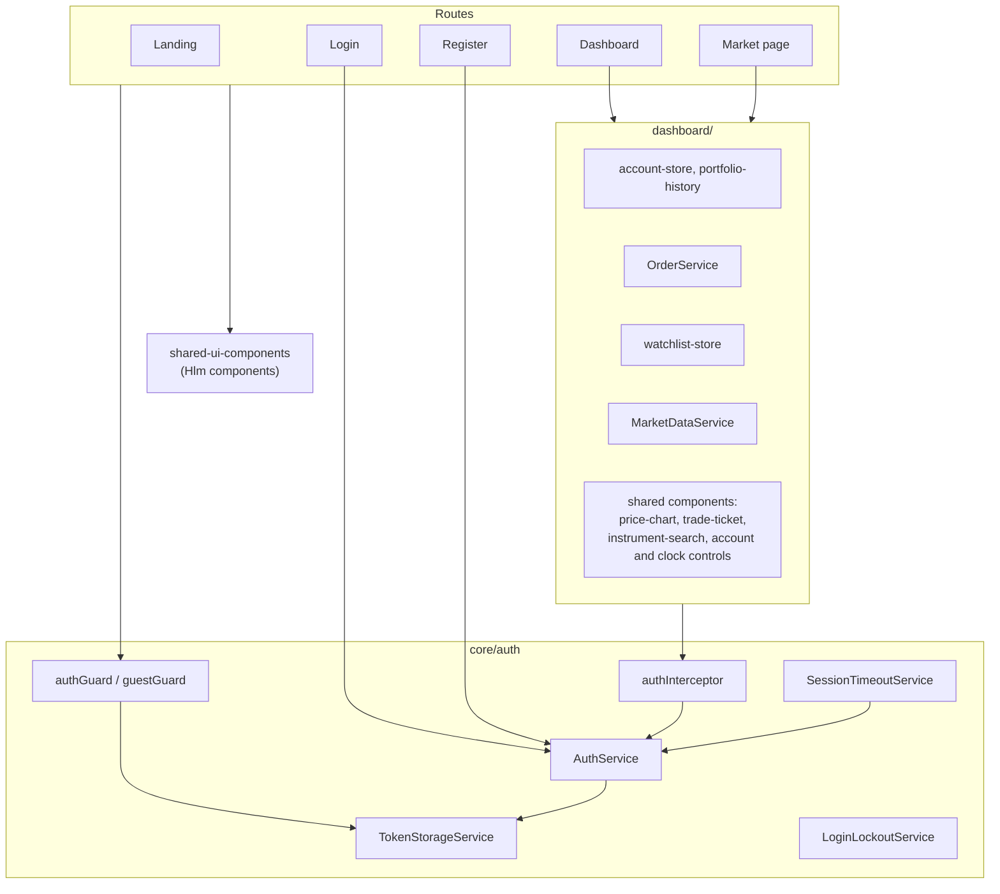
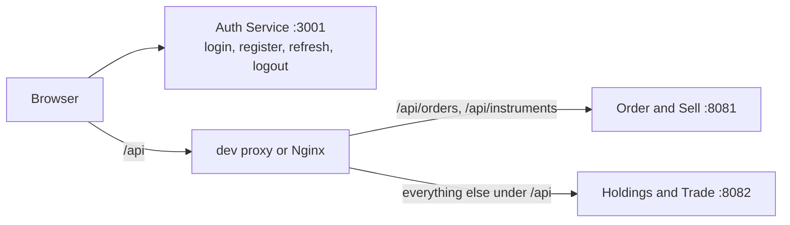
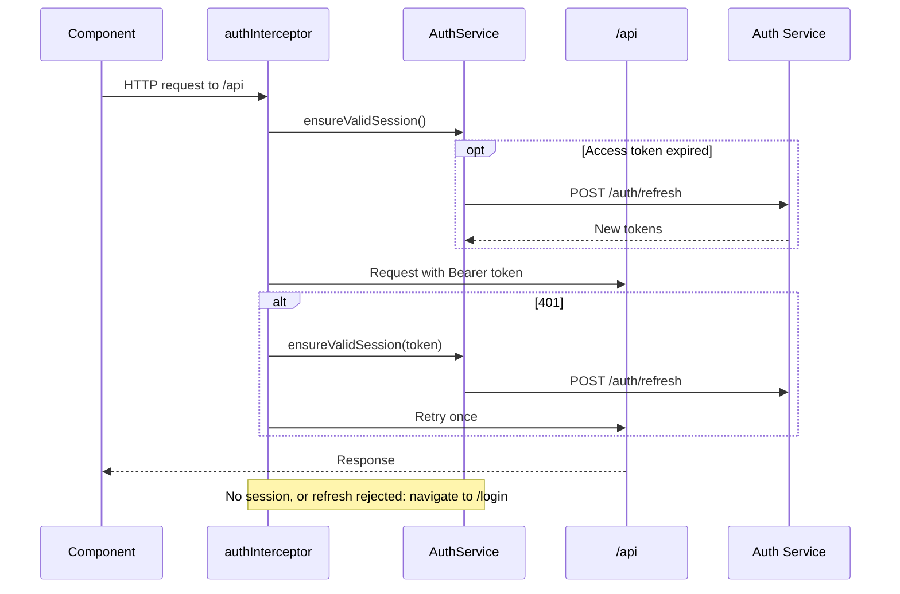

# Client UI

Angular 21 single-page app with standalone components, signals, reactive forms, and OnPush change detection. Server-side rendering runs through the Angular SSR server.

| Route | Guard | Screen |
| --- | --- | --- |
| `/` | none | Landing page |
| `/login`, `/register` | guests only | Sign in and registration |
| `/dashboard` | signed in | Accounts, holdings, portfolio history, watchlist, market ticker, order dialog, recent transactions, [first-run tour](#first-run-tour) |
| `/dashboard/markets/:symbol` | signed in | Full-screen instrument page: chart modes and indicators, account and simulation-time controls, order ticket, recent orders |

Live prices, candles, and the tick stream come from the Java market API. Metrics, news, and AI commentary on the market page are demo data. Users are signed out after a period of inactivity, 10 minutes by default and configurable in settings.

A user who has not accepted the platform terms in force sees them on the dashboard and on the market page in a dialog that cannot be dismissed, with everything behind it inert. They sign by typing their name and accept, or sign out. The wording and its version are in [terms-content.ts](src/app/dashboard/terms/terms-content.ts); the version must match the one [Holdings and Trade Service](../holdings-and-trade-service/README.md) and [Order and Sell Service](../order-and-sell-service/README.md) have in force, which a test in each of them checks. After changing the wording, run `npm --prefix apps/client-ui run terms:pdf` to regenerate [the PDF](../../docs/terms-and-conditions.pdf) from it.

## First-run tour

The dashboard opens a short spotlight tour the first time it loads in a browser, once the accounts and profile have arrived and no terms are waiting to be accepted. It covers seven steps: a welcome, then the stock search, net worth, the account menu, the portfolio chart, and Assets and Watch List, ending with a button that focuses the search. Each step dims the page around one element and explains it in a card beside it, and the dashboard is inert while the tour is open. Esc or Skip closes it, and the arrow keys move between steps. Profile menu, then Take the tour, starts it again.

The tour remembers per browser, not per user, whether it was finished or skipped (`ts.tour.done`) and the step to resume at after a reload (`ts.tour.step`). Steps find their elements by `data-tour` attributes in [dashboard.component.html](src/app/dashboard/dashboard.component.html). The steps and their copy are in [dashboard-tour.component.ts](src/app/dashboard/tour/dashboard-tour.component.ts). The design follows the tour in the TradingSeason design system.

## Architecture



### Request routing



The split is configured twice: [proxy.conf.json](proxy.conf.json) for `ng serve` and [nginx.conf](nginx.conf) for the container image. Add a new backend path to both. The auth service is called directly; its CORS policy allows the dev origin.

### Token renewal



Network and refresh-service failures keep the credentials so the request can be retried; sign-out happens on explicit logout, inactivity, or missing or rejected refresh credentials.

## Loading states

While data is on its way, the part of the screen that waits for it shows placeholders in the shape of what is coming: pulsing blocks where the figures, rows and charts will be. A figure is not shown as zero, and a list is not shown as empty, until the answer says so.

| Screen | Placeholder | Shown until |
| --- | --- | --- |
| Dashboard | Net worth, allocation and the invested and cash line; the portfolio card; the account menu's label and its accounts; rows of the assets table | The accounts, holdings and cash arrive |
| Dashboard | Rows of Recent Transactions | The orders and the accounts arrive |
| Dashboard | The portfolio chart | The portfolio history of the chosen range arrives |
| Dashboard | Rows of the watch list | The watch list arrives |
| Transactions dialog | Rows of the table, when there is nothing to list yet | The full cash ledger arrives |
| Market page | The whole page: summary, chart panel and tools column | The market snapshot arrives |
| Market page | The chart, and each chart of a comparison | Its candles arrive |
| Market page | Available cash, portfolio value, the account menu and the account named above Recent Orders | The accounts arrive |
| Market page | Rows of Recent Orders | The orders and the accounts arrive |

A placeholder is the `skeleton` class in [src/styles.css](src/styles.css), sized with utilities; a list row has its own in [activity-row.component.ts](src/app/dashboard/shared/activity-row.component.ts). The blocks are hidden from assistive technology, and a visually hidden status beside them says what is loading, so a screen reader hears "Loading accounts" as before. The pulse stops under `prefers-reduced-motion`. A load that fails shows its error and retry in place of the placeholder, and a refresh of data already on screen leaves it there. The [Reporting UI](../reporting-ui/README.md#design-system) declares the same class; keep the two alike.

## Commands

client-ui is an independent npm project with its own lockfile. From the repository root:

```sh
npm --prefix apps/client-ui ci
npm --prefix apps/client-ui start
npm --prefix apps/client-ui run build
npm --prefix apps/client-ui test -- --no-watch
npm --prefix apps/client-ui run e2e
```

`ng serve` runs on port 4200 and proxies `/api` as above. Use `--no-watch` for Angular tests; Vitest's `--run` is not supported by the builder.

The production [Dockerfile](Dockerfile) builds the app and serves it through unprivileged Nginx, with SPA fallback and the `/api` proxy.

## Tests

- **Unit**: `*.spec.ts` beside the code under `src`, on the Angular unit-test builder with Vitest. The run fails below 90 percent on statements, branches, functions, or lines (`coverageThresholds` in [angular.json](angular.json)). Add `--coverage` for the report.
- **End-to-end**: Playwright in [e2e](e2e), excluded from the unit-test builder. Install the browser once with `npx --prefix apps/client-ui playwright install chromium`; the suite builds the app and serves it on port 4200 (or reuses a server already there). The auth service and Java backend are replaced by an in-memory [API stand-in](e2e/fixtures/api-stub.ts), so no database or backend is needed. The [test fixtures](e2e/fixtures/test.ts) mark the first-run tour as finished so it does not cover the dashboard; a test of the tour sets `tourDone: false`. Update the stand-in whenever an auth, account, cash, order, or terms contract changes.

## Shared components

[shared-ui-components](shared-ui-components/README.md) holds the Spartan/Tailwind component library compiled into this app. Only this app consumes it.
