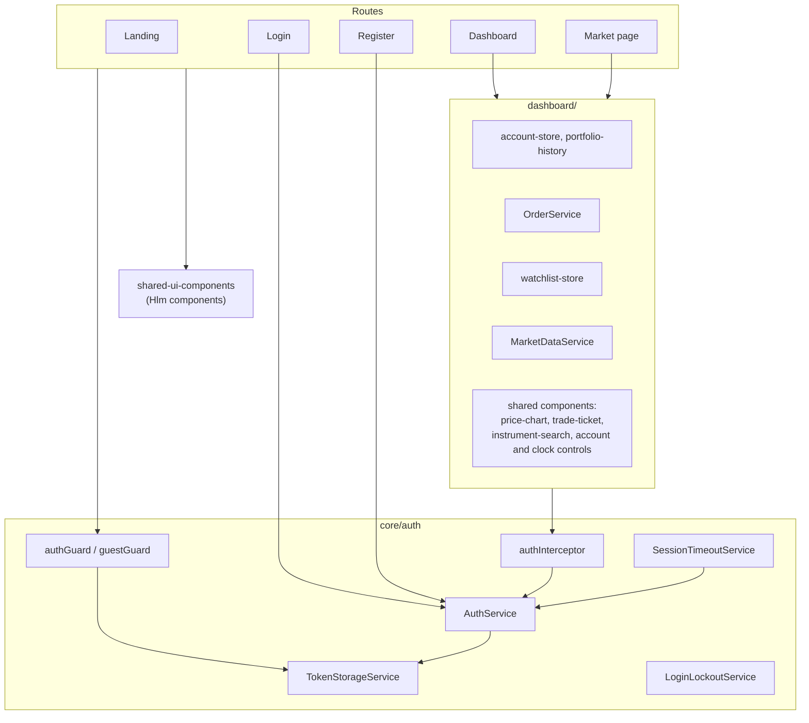
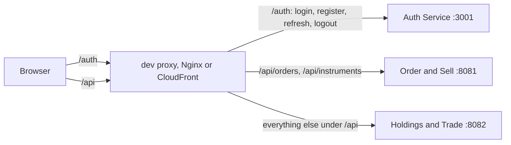
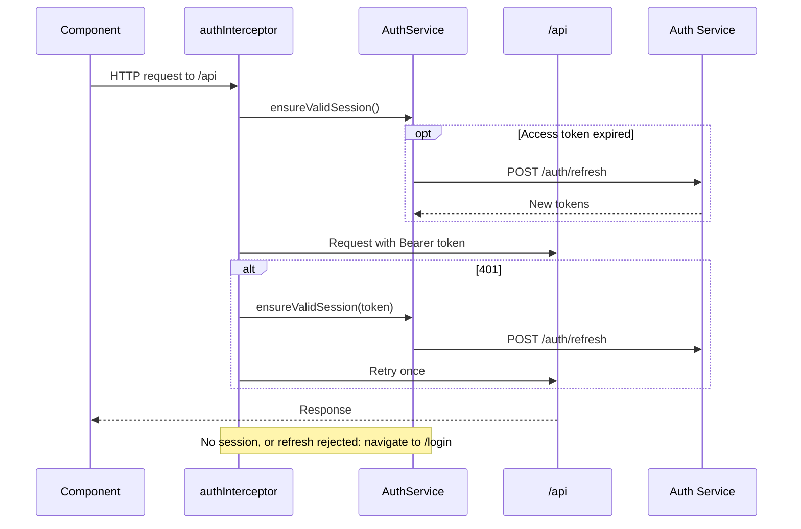

# Client UI

Angular 21 single-page app with standalone components, signals, reactive forms, and OnPush change detection. Server-side rendering runs through the Angular SSR server.

| Route | Guard | Screen |
| --- | --- | --- |
| `/` | none | Landing page |
| `/login`, `/register` | guests only | Sign in and registration |
| `/dashboard` | signed in | Accounts, holdings, portfolio history, watchlist, market ticker, order dialog, recent transactions, [first-run tour](#first-run-tour) |
| `/dashboard/markets/:symbol` | signed in | Full-screen instrument page: chart modes and indicators, account and simulation-time controls, order ticket, recent orders |

The market page places the account selector beside the simulation-time control. Its right panel matches the chart column's height on desktop and scrolls internally. Trading is the default tab, with Available Cash and Portfolio Value above Order Execution; Overview, News, AI, Outlook and Recent Orders share that panel. The chart's indicator menu also offers Volatility outlook, a pane under the price chart (like RSI) that draws the platform model's chance of bigger price swings over the next five trading days, reading by reading up to the simulated clock, and shades the stretches whose window turned out to have bigger swings once it had closed; a key under its title names the line, the shading and the dots, the axis reads "More likely" and "Less likely" around the 50% line, and on ranges with at most forty closed readings each reading gets a dot, green where its call came true and red where it missed, so the pane shows whether the model saw the rough weeks coming; it reads the same signal file as the Outlook card and is meaningful on the 1M and 1Y ranges. Outlook is the week-ahead volatility card for the instrument, in a user's words: whether to expect bigger or smaller price swings over the next five trading days than that stock's recent normal (user testing showed "stormier/calmer than usual" was not understood), read from the static `public/forecast/platform-signals.json` the stock forecast pipeline writes (see [its README](../holdings-and-trade-service/stock-forecast/README.md)). It is built to be read in one glance: a tinted panel with the call ("Bigger price swings likely"), "up or down, not a direction", a row of dots for the last reads (correct or missed) and one accuracy figure. A Details toggle reveals the proof: the numbers sentence, a meter showing where the model's probability sits between smaller and bigger swings, two tiles with the model's and the recent pattern's reads and their accuracy over the last twenty closed weeks (the one with the better record on that stock over those weeks, counted only over windows closed by the simulated date, leads the headline and is marked as such; the file's running totals since July are not used, because a source that read the recent regime better is the better guide to the next week), and every recent read with its outcome. The reads listed are the last six whose week had closed by the simulated date, each as the card showed it then, so the track record is visible rather than asserted. It reads the simulated clock, never the real date, and states that it is a read on how much the stock may move, never a recommendation. Compact cash and portfolio cards sit above the order ticket. The Buy/Sell action sits at the bottom, with flexible space after the estimated cost or proceeds. The account and simulation-time dropdowns and the profile and notification buttons are 46px tall and vertically centered beside the search field and back button. Switching tabs preserves the order draft. Smaller screens stack the chart and tools.

Live prices, candles, and the tick stream come from the Java market API. Metrics, news, and AI commentary on the market page are demo data. Users are signed out after a period of inactivity, 10 minutes by default and configurable in settings.

A user who has not accepted the platform terms in force sees them on the dashboard and on the market page in a dialog that cannot be dismissed, with everything behind it inert. They sign by typing their name and accept, or sign out. The wording and its version are in [terms-content.ts](src/app/dashboard/terms/terms-content.ts); the version must match the one [Holdings and Trade Service](../holdings-and-trade-service/README.md) and [Order and Sell Service](../order-and-sell-service/README.md) have in force, which a test in each of them checks. After changing the wording, run `npm --prefix apps/client-ui run terms:pdf` to regenerate [the PDF](../../docs/pdf/terms-and-conditions.pdf) from it.

## First-run tour

The dashboard opens a short spotlight tour the first time it loads in a browser, once the accounts and profile have arrived and no terms are waiting to be accepted. It covers seven steps: a welcome, then the stock search, net worth, the account menu, the portfolio chart, and Assets and Watch List, ending with a button that focuses the search. Each step dims the page around one element and explains it in a card beside it, and the dashboard is inert while the tour is open. Esc or Skip closes it, and the arrow keys move between steps. Profile menu, then Take the tour, starts it again.

The tour remembers per browser, not per user, whether it was finished or skipped (`ts.tour.done`) and the step to resume at after a reload (`ts.tour.step`). Steps find their elements by `data-tour` attributes in [dashboard.component.html](src/app/dashboard/dashboard.component.html). The steps and their copy are in [dashboard-tour.component.ts](src/app/dashboard/tour/dashboard-tour.component.ts). The design follows the tour in the TradingSeason design system.

## Dua insights

Dua is a fixed 52px shark launcher at bottom-right on the dashboard and market page, without reserved layout space. The panel starts closed and closes on navigation. Its supplied [launcher image](public/assets/assistant/shark-launcher-light-512.png) centers the fin at rest (2.2x scale); hover, keyboard focus, pending notifications and open chat reveal the face (1.35x scale), using a 450ms transition disabled for reduced motion. The initial header reads Dua - Free Plan.

The choice-based assistant uses existing data and factual templates:

- **Volatility outlook** (first, shown as live with a breathing gradient border): the week-ahead read for the open instrument, or the first holding on the dashboard, from the same signal file as the market page's Outlook card. Its teaser line carries the stock, the call in plain words and the leading record's accuracy over the last twenty closed weeks; the card shows the model estimate, the accuracy so far and the usual and recent daily moves, and a button opens the market page with the Outlook tab already selected (`?tab=outlook`, a tab name, never an account id).
- **Daily review:** illustrative Market Overview (+1.8% S&P 500, Today), Portfolio Impact (+$385, Today), and Tomorrow's Outlook (3 events, Up Next). Explanations clarify that figures and schedules are fictional, not actual market or account data.
- **My holdings:** three static placeholder cards styled like Stock Insights: Portfolio Growth (+12.4%, $2,450, This Month), Sector Concentration (68% technology, Current), and Top Performer (NVIDIA +32.8%, $1,280, This Month). Explanations identify these as examples, not selected-account calculations.
- **This stock:** three illustrative Growth, Valuation and Risk previews using the supplied example figures (+24.8%, -18%, 65%). Every card shows the captured market date; the explanations identify the example data, and the header reads Stock Insights. No history or fundamentals requests are made.

The 360px-wide panel shows one consistent-height card at a time, with three navigation bars for each choice. Cards use a continuous teal/purple result-body gradient without black outer gutters, fading to dark at the bottom, while the header stays black. Large white numbers and directional arrows accompany short, safely interpolated takeaways with key results in bold. Stock-list changes retain signs and green/red colors. Compact lists scroll internally; card content remains accessible on short viewports or enlarged text. A circled question-mark icon opens Explain these numbers at the top right beside the card title; returning from explanations restores the same snapshot. Refresh/retry is an icon beside close, with snapshot time only beside the title. See the [canonical insight and interaction rules](../../docs/dua-insights-mvp-plan.md) for dimensions and calculations.

Existing market and holdings data establish a notification baseline independently of the displayed placeholders. Changes to rounded insight results or the trading date can trigger one red **1** badge, without extra requests. Clicking it opens chat and clears the badge in one click. Further notifications are suppressed across navigation/account changes until a full page refresh. Hover does not acknowledge it. Preserve logout, account/simulation context, terms blocking, loading skeletons and unavailable states. No backend, model, free text, persistent chat history or trading action is added.

## Architecture



### Request routing



The split is configured twice: [proxy.conf.json](proxy.conf.json) for `ng serve` and [nginx.conf](nginx.conf) for the local container image. Add a new backend path to both. The auth service is reached through the same proxy on `/auth`, so every call is same origin and needs no CORS entry. A deployment on S3 must route the same paths; see [Static UIs on S3](../../infrastructure/README.md#static-uis-on-s3).

### Token renewal



Network and refresh-service failures keep the credentials so the request can be retried; sign-out happens on explicit logout, inactivity, or missing or rejected refresh credentials.

## Loading states

Recent activity rows show order details and plain-text status beneath the transaction label, with the timestamp beneath the amount. Buy, Sell, Deposit and Withdrawal badges appear immediately to the right of the ticker or transaction label, vertically centered on that line. The dashboard and market page share these rows.

The Recent Transactions dialog names the account each order was placed in (cash transfers show "All accounts", since cash is shared) and marks limit, stop and stop-limit orders beneath the type. Its filter panel narrows by type, status, order kind (market, limit, stop, stop-limit) and account; choosing an account or an order kind leaves out cash transfers, which belong to no single account and have no order kind.

The View All transactions table reserves a narrow actions column after Value, keeping order menus separate from prices and aligned across rows. Order menus close when clicking outside them or opening another order's menu.

While data is on its way, the part of the screen that waits for it shows placeholders in the shape of what is coming: pulsing blocks where the figures, rows and charts will be. A figure is not shown as zero, and a list is not shown as empty, until the answer says so.

| Screen | Placeholder | Shown until |
| --- | --- | --- |
| Dashboard | Net worth, allocation and the invested and cash line; the portfolio card; the account menu's label and its accounts; rows of the assets table | The accounts, holdings and cash arrive |
| Dashboard | Rows of Recent Transactions | The orders and the accounts arrive |
| Dashboard | The portfolio chart | The portfolio history of the chosen range arrives |
| Dashboard | Rows of the watch list | The watch list arrives |
| Order dialog | A chart placeholder in a stable chart area; loading, empty and error states keep the same space | The selected instrument's candles arrive |
| Transactions dialog | Rows of the table, when there is nothing to list yet | The full cash ledger arrives |
| Market page | The whole page: summary, chart panel and tools column | The market snapshot arrives |
| Market page | The chart, and each chart of a comparison | Its candles arrive |
| Market page | Available cash, portfolio value, the account menu and the account named above Recent Orders | The accounts arrive |
| Market page | Rows of Recent Orders | The orders and the accounts arrive |
| Market page | The Outlook card | The signal file arrives |

A placeholder is the `skeleton` class in [src/styles.css](src/styles.css), sized with utilities; a list row has its own in [activity-row.component.ts](src/app/dashboard/shared/activity-row.component.ts). The blocks are hidden from assistive technology, and a visually hidden status beside them says what is loading, so a screen reader hears "Loading accounts" as before. The pulse stops under `prefers-reduced-motion`. A load that fails shows its error and retry in place of the placeholder, and a refresh of data already on screen leaves it there. The [Reporting UI](../reporting-ui/README.md#design-system) declares the same class; keep the two alike.

## Commands

client-ui is an independent npm project with its own lockfile. From the repository root:

```sh
npm --prefix apps/client-ui ci
npm --prefix apps/client-ui start
npm --prefix apps/client-ui run build
npm --prefix apps/client-ui test -- --no-watch
npm --prefix apps/client-ui run e2e
```

`ng serve` runs on port 4200 and proxies `/api` as above. Use `--no-watch` for Angular tests; Vitest's `--run` is not supported by the builder.

The [Dockerfile](Dockerfile) builds the app and serves it through unprivileged Nginx, with SPA fallback and the `/api` and `/auth` proxies. It is the local stand-in for S3 behind CloudFront, used by Local Compose only (Jenkins builds no UI image), not the deployable artifact: deploy `dist/client-ui/browser` to S3 as [Static UIs on S3](../../infrastructure/README.md#static-uis-on-s3) describes.

## Tests

- **Unit**: `*.spec.ts` beside the code under `src`, on the Angular unit-test builder with Vitest. The run fails below 90 percent on statements, branches, functions, or lines (`coverageThresholds` in [angular.json](angular.json)). Add `--coverage` for the report. [vitest.config.ts](vitest.config.ts) uses Vitest 4's `maxWorkers: 1` and disables file parallelism to limit contention with the other Jenkins suites.
- **End-to-end**: Playwright in [e2e](e2e), excluded from the unit-test builder. Install the browser once with `npx --prefix apps/client-ui playwright install chromium`; the suite builds the app and serves it on port 4200 (or reuses a server already there). The auth service and Java backend are replaced by an in-memory [API stand-in](e2e/fixtures/api-stub.ts), so no database or backend is needed. The [test fixtures](e2e/fixtures/test.ts) mark the first-run tour as finished so it does not cover the dashboard; a test of the tour sets `tourDone: false`. Update the stand-in whenever an auth, account, cash, order, or terms contract changes.

## Shared components

[shared-ui-components](shared-ui-components/README.md) holds the Spartan/Tailwind component library compiled into this app. Only this app consumes it.

## Removing a portfolio account

The three-dot button in the portfolio dropdown opens account settings. Delete Account is the red shared button on the left. It opens a confirmation explaining that the account is archived and its history retained for reporting. Requirements are checked before enabling Delete, and the backend rechecks them atomically. An unmet requirement is displayed next to the action; submission errors retain the confirmation so the user can retry.

Successful deletion refreshes accounts, shared cash, and transactions and selects an available active account. Archived accounts disappear from the client's portfolio selector and active balances. There is no client history section for archived accounts. See the [lifecycle contract](../holdings-and-trade-service/api.md).

## Trading preferences and execution types

Settings > Trading Preferences saves a user-wide 0-10% execution buffer, defaulting to 1%, through the [profile API](../holdings-and-trade-service/api.md#trading-preferences). Both order tickets share the account-style rounded order-type dropdown, initially showing Market. The shares card contains only quantity and its slider. The summary price row shows the market quote for Market orders, an editable price for Limit or Stop orders, and side-by-side Stop and Limit inputs for Stop-Limit orders. The price row keeps a fixed height across order types. The order modal sizes to its ticket content, with a viewport height cap, internal scrolling and opacity-only entrance animation. Preference and chart loading do not reposition the ticket or its submit button. In Edit Order, the graph expands into the removed search bar's space. Editable prices have an external dollar sign, larger text, and an empty-field highlight, with accessible labels. Buffer and reservation calculations remain internal to the ticket without extra helper text. Market uses the submission quote and Stop uses its first triggering quote with the saved buffer; Limit and Stop-Limit respect explicit limits. The server captures its own submission quote. Order placement and later fills use success toasts for all execution types. Recent activity and transaction history display entered conditional prices (both Stop and Limit for Stop-Limit), retaining actual prices for fills. Open orders offer a three-dot menu beside the amount or price, spanning the transaction row height, with Edit order reopening the stock ticket and Cancel order using centered confirmation. Edits prefill the original quantity/type/prices and retain the account, stock and side; saving atomically replaces the order. Accepted/Open status uses blue styling. These actions are available in recent activity and transaction history. Open orders expire at their submission simulation day's Chicago market close. Expired orders appear as Cancelled in recent activity without an expiry suffix or explanation. Buying power and sellable shares exclude reservations; valuations retain total balances.

Market chart indicators start at the first available candle, using available history until their full period is reached. SMA, EMA and Bollinger Bands use up to 20 candles; RSI uses up to 14 price changes and starts at a neutral 50. Latest appears at the top right beside enabled indicator labels when the chart is away from the latest bars, including both comparison charts.

Each comparison chart places its ticker, price, USD dollar change, signed percentage change, chart controls and Latest in one header row above the plot, wrapping only when space requires it. Comparison mode hides the active indicator badges while keeping their chart overlays and RSI enabled.


This stock previews use a large percentage, a larger white result headline with emphasized words, with supporting descriptions available from the question-mark icon. Each card shows its position (01 / 03 through 03 / 03) and the captured market date. Direction arrows are large and light green/red; Daily review and My holdings also use illustrative cards, with existing navigation and notification behavior. Revenue, valuation and geographic figures remain illustrative until a real fundamentals source is implemented.

Stock preview metric titles sit above the number in larger white text. The small metadata row shows the captured market date (MM/DD/YYYY) and card count, not a financial reporting date. The header reads Stock Insights; explanations state that figures are illustrative. Reduced card height and bottom padding keep navigation close to the description.

All Daily review, My holdings and stock preview cards share the same label-above-number layout, larger white metric labels, consistent top spacing, and a period-or-date/card-count row. The date is the viewed market context, not a financial reporting date. Card heading and metadata spacing is compact; signed values, directional colors, consistent section heights and internal scrolling are preserved.

The stock section header reads Stock Insights. Stock metric titles have 14px of spacing above them after the date/card-count row. These stock figures remain illustrative, as described in the explanation panel.

My holdings uses the same gradient, metric-first typography, circled explanation action and three-card navigation as Stock Insights. Its metadata row displays This Month or Current rather than a date. Refresh returns to Portfolio Growth. These examples do not derive from selected-account holdings, sector classification or monthly return history; Daily review also uses illustrative placeholders and existing notification behavior is preserved.

Daily review uses the shared three-card illustrative layout with Today/Up Next labels, large metrics, short result headlines with descriptions behind the question-mark icon. The explanation icon states that all figures and events are examples, not actual market data or the selected account's results. No event-calendar or market-news requests are made. Existing pure market/holdings calculations remain available for tests and notification baselines; they do not supply the displayed placeholder cards.

All three insight choices keep supporting gray descriptions off the main cards. The circled question mark opens a card-specific explanation with the same gradient and black header: a short result summary, Why it matters reasoning from the placeholder example, and a compact illustrative-data clarification. Returning restores the same card and snapshot without requests or recalculation.

Insight sections size naturally to their tallest card instead of reserving a fixed 320px. All slides share one grid cell so navigation stays in place as cards change and text wraps responsively. Inactive slides remain invisible, inert and hidden from assistive technology; overflowing content retains scrolling on short viewports or with enlarged text. Compact bottom padding keeps the headline close to navigation.

Question-mark explanation views also use content-driven height, matching insight-card padding and the same viewport height cap. Short explanations have no reserved blank space below their text; long explanations scroll internally when required by viewport size or enlarged text.

Card changes use a 380ms fade/short slide with the same gentle ease-in-out as resizing, and content-view changes ease the measured panel height over 380ms with gentle ease-in-out while remaining anchored above the launcher. Rapid changes continue from the current animated height; reduced-motion preferences disable both effects. The final size remains content-driven and viewport-constrained, with 12px card bottom padding and 12px navigation margins.

Information views use 36px bottom padding so their last paragraph has the same breathing room as the insight content above navigation. Their height remains content-driven and uses the shared resize transition.

Information views use a consistent 14px type scale and 1.55 line height, with semibold headings/emphasis and regular body copy. Opening and returning use a 280ms content entrance and a 380ms height transition. The panel bottom remains anchored 12px above the fixed launcher; resizing changes the top edge only. Reduced-motion preferences disable animation.

Card transitions animate opacity and a small visual translation only; the shared grid row and navigation never change size or position during a card switch. Navigation indicator colors fade over the same 380ms without layout movement. Reduced motion switches cards and indicators immediately.
