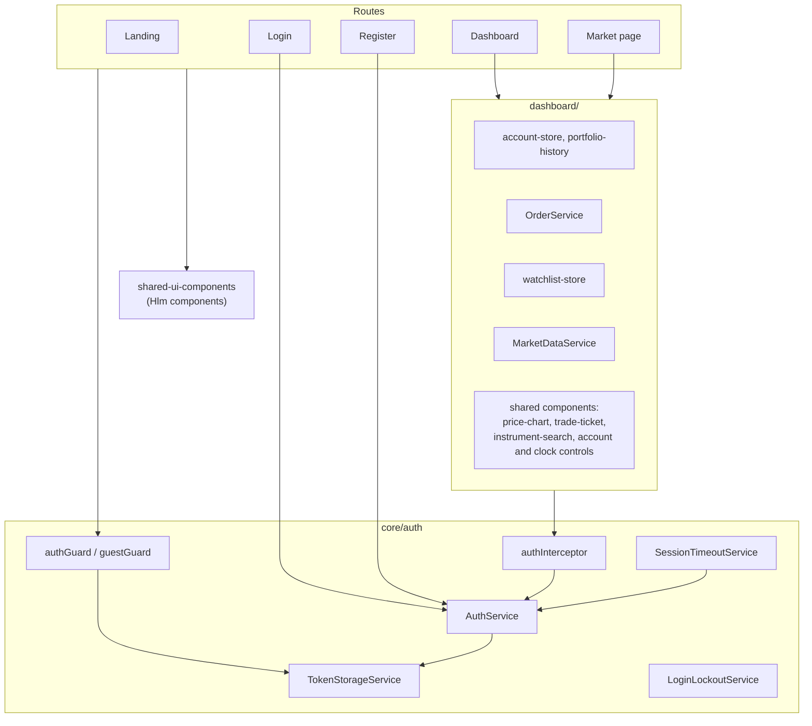
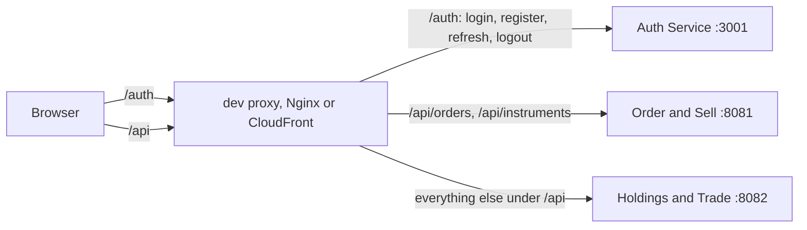
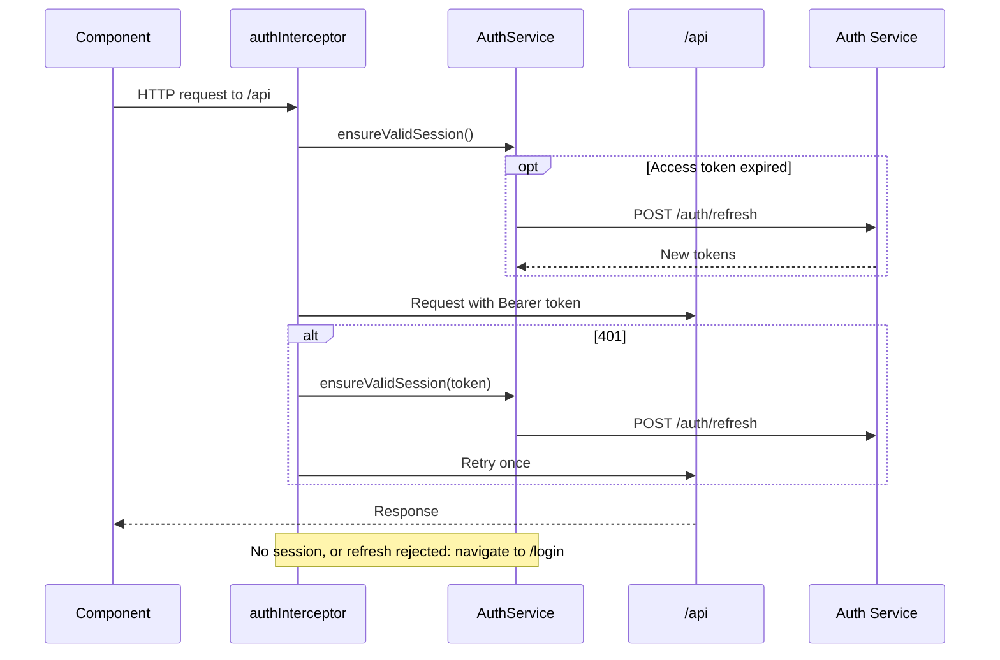

# Client UI

Angular 21 single-page app with standalone components, signals, reactive forms, and OnPush change detection. Server-side rendering runs through the Angular SSR server.

| Route | Guard | Screen |
| --- | --- | --- |
| `/` | none | Landing page |
| `/login`, `/register` | guests only | Sign in and registration |
| `/dashboard` | signed in | Accounts, holdings, portfolio history, watchlist, market ticker, order dialog, recent transactions, [first-run tour](#first-run-tour) |
| `/dashboard/markets/:symbol` | signed in | Full-screen instrument page: chart modes and indicators, account control and simulated market time, order ticket, recent orders |

Both page headers show the simulated market time read-only, with a Closed badge outside 8:30 AM to 3:00 PM CT; the time is changed in Settings > Market clock and takes effect with Settings' Save all button, which reports the new time back to the page that opened it. After the close the clock keeps running with prices held until midnight, then moves to the next trading day. The market page places the account selector beside the market time. Its right panel matches the chart column's height on desktop and scrolls internally. Trading is the default tab, with Available Cash and Portfolio Value above Order Execution; Recent Orders shares that panel. Compact cash and portfolio cards sit above the order ticket. The Buy/Sell action sits at the bottom, with flexible space after the estimated cost or proceeds. The account and simulation-time dropdowns and the profile button are 36px tall and vertically centered beside the search field and back button. Switching tabs preserves the order draft. Smaller screens stack the chart and tools. The lightning Live tailing toggle, an icon at the end of the chart navigation bar, enables live tailing for both charts: it jumps to the latest bars and follows incoming updates while preserving zoom. It starts enabled. Panning back with the arrow controls, dragging, or horizontal scrolling turns it off automatically for both charts. Turning it off keeps the current window while prices continue updating; enable it again to resume following the latest bars. Beside the navigation bar, the cyan Forecast button opens the forecast drawer ([forecast-drawer.component.ts](src/app/market-page/forecast-drawer/forecast-drawer.component.ts)) over the right of the chart, never over the order ticket: both model forecasts for the stock (direction, which can be no clear direction, and price swings with their meter), each with its record over closed weeks, each scored beside the simple pattern it has to beat, and the not-advice notice once. A `?forecast=open` link opens it too, and closing drops that parameter and returns focus to the button. Escape closes it.

Hover details on the market page charts, the order ticket chart and the dashboard portfolio chart sit at the top of the plot, centered above the hovered point, so they do not move vertically. When the hovered point is high enough that the label would cover it, the label moves beside the point, still along the top.

Live prices, candles, and the tick stream come from the Java market API. Supplementary metrics on the market page are demo data. Users are signed out after a period of inactivity, 10 minutes by default and configurable in settings (applied with Save all); for the last minute Dua asks whether they are still there, and any input, in any tab, clears the question.

A user who has not accepted the platform terms in force sees them on the dashboard and on the market page in a dialog that cannot be dismissed, with everything behind it inert. They sign by typing their name and accept, or sign out. The wording and its version are in [terms-content.ts](src/app/dashboard/terms/terms-content.ts); the version must match the one [Holdings and Trade Service](../holdings-and-trade-service/README.md) and [Order and Sell Service](../order-and-sell-service/README.md) have in force, which a test in each of them checks. After changing the wording, run `npm --prefix apps/client-ui run terms:pdf` to regenerate [the PDF](../../docs/pdf/terms-and-conditions.pdf) from it. The terms' version is the date of their wording (`TERMS_VERSION` in `dashboard/terms/terms-content.ts`, which must equal `UserService.CURRENT_TERMS_VERSION` in Holdings and Trade); version 2026-10-21 added the section on model reads and trade signals, so every user accepts again.

## Dua insights

Dua is a fixed 72px launcher with a panel up to 420px wide and 640px tall, capped to the viewport. On wide screens away from a stock page, a closed launcher carries an Ask Dua label with its new-insight count, hidden while Dua speaks. The dashboard starts closed; the first stock market page of a visit opens the menu without moving focus, and later stock pages leave a dismissed Dua closed so it does not keep covering the order ticket. Opening the dashboard order dialog opens it every time, whose stock (following its search) is the one This Stock reviews. While that dialog is open Dua sits above its backdrop. Outside clicks, Escape and minimize close it; Escape inside Dua closes only Dua. Live ticks do not reopen a dismissed panel. Terms acceptance hides Dua.

The menu contains This Stock (when a symbol is selected), Daily Review and Portfolio Analysis. Once a choice is open, the header names the selected trading account, and every result except the watchlist is computed for that account alone. Each card shows when its snapshot was taken ("As of today, 9:05 AM", or yesterday, or a date, relative to the simulation day) and its position ("Page 1 of 3"). Cards lead with short guidance, or with their amount when the amount is the result, followed by a statement that explains it. Dollar amounts and arrows stay on one line; long amounts use a full row. The info icon in each card heading (labelled View Details) opens evidence inside Dua, and Back restores the card, snapshot and scroll position. The market tools have Trading and Recent Orders; legacy `?tab=outlook` links open volatility details inside Dua.

This Stock has three cards. The ticker analysis suggests buying when the direction forecast leans up, selling when it leans down and the account holds the stock, and holding off otherwise, followed by the forecast direction; when the strong-trend read makes no call, because the stock's recent move is too small against its usual swings, it says there is no clear direction instead. It does not show the user's position. Trending activity states momentum as the percentage move over the trend window and volume as a percentage above or below usual. The volatility outlook states bigger or smaller swings, the chance of that call in plain words, and a smaller-to-bigger swings scale marking the model estimate. It reuses the existing stock-forecast `platform-trend.json` and `platform-signals.json` services: the direction call is the trend file's strong-trend read, and the volatility call keeps the model-versus-pattern selection. A model chance is quoted only when it agrees with the call shown. Only readings available before the simulation day are eligible. Details for these cards are a few plain sentences: what the forecast estimates and the chance where it applies. The volatility card fits without scrolling. Volume compares the latest completed session with the previous 20 completed sessions. Guidance describes simulation data, not popularity or real-market advice. Cards whose call comes from a model forecast (the ticker analysis, the volatility outlook, and a buy or sell suggestion in Portfolio Analysis) carry a Model forecast badge, a See the forecast link to that stock's forecast drawer, and their record under the call: one dot per recent closed call and a line such as "Right 12 of last 16 calls · called 16 of 24 weeks". While one is showing, the panel's border rests in the brand hue with a faint glow, and a band of light runs once round it as the card comes into view (no sweep under reduced motion). Their styles are in [dua-forecast.css](src/app/dua/dua-forecast.css).

Daily Review shows account performance since the open and the position that drove it, the top three gainers and losers including sold positions, and how many watchlist stocks are rising and falling since the open with their average move, without naming them (the watchlist is per user, so it is the same for every account). Portfolio Analysis shows week-to-date (from Monday) and month-to-date amounts together with one short line naming the position behind each, the biggest gainer and loser for each, and a suggestion that explains why and what the user could do. Performance is ending holdings value minus starting value minus purchases plus sale proceeds; shared cash and deposits are excluded. Daily baselines use session open; week/month baselines use the prior available close, else the earliest open within the period when older history is not available. A fill without a recorded execution price uses its indicative price, as the rest of the app does. Positions with no price history at all are left out of totals and rankings and named in the statement, instead of substituting average purchase cost. The suggestion is to buy, sell or hold: sell a holding only when it is the period's largest loss and its direction reading is also down, otherwise buy the stock with the strongest momentum among upward readings, and hold when neither applies.

Dua is animated, all of it switched off under `prefers-reduced-motion`: the panel springs out of the launcher, the greeting and choices enter in sequence, pages slide in from the direction navigated, their content focuses in from top to bottom, headline amounts pop and count up from zero, direction arrows hop, sparklines and distribution bars draw in, the volatility marker slides to its reading and pings, and the active page indicator fills like a progress bar. A counting amount keeps its final text in the DOM for layout and assistive technology. Motion lives in [dua-motion.css](src/app/dua/dua-motion.css) and [the count-up directive](src/app/dua/dua-count-up.directive.ts).

Blue animated borders and New labels identify unread choices, with static blue borders for reduced motion. Opening the menu does not acknowledge content. Rendering a foreground summary acknowledges its exact version through the [read-state API](../holdings-and-trade-service/api.md#dua-read-state). Versions are independent by account, simulation, category and stock. Date changes, fills, forecast changes and suggestion/activity classification changes create updates; ordinary numeric ticks do not. Existing results remain snapshots until Update available appears and is used; there is no manual refresh, and a failed load offers Try again. State synchronizes on context activation, window focus and every minute while open; failed writes retry without re-highlighting locally viewed content. The launcher badge counts unread choices.

See [Dua](src/app/dua/dua.component.ts), [performance calculations](src/app/dua/dua-guidance.ts) and [viewed state](src/app/dua/dua-session.service.ts).

### Dua as a companion

Dua is drawn as an SVG ([dua-figure.component.ts](src/app/dua/dua-figure.component.ts)) traced from the launcher artwork in `public/assets/assistant`, with six expressions: happy, sleepy, shy (flippers over its eyes), peek (one flipper lowered), worried and excited. Its face keeps the `--dua-face` colors in both themes. Beyond the insights panel, Dua appears across the app:

- Order outcomes (fills, placed and updated orders, rejections and submission errors) and later fills are said by Dua in a speech bubble beside the launcher instead of a toast, through [DuaSpeech](src/app/dua/dua-speech.service.ts). A line stays 6 seconds (7 for a celebration, 8 for an error), a newer line replaces it, and Dua's face matches its tone. The bubble sits inside a polite live region, or an alert for errors, so screen readers announce it once. The toaster remains for other notices.
- The panel greets the user by first name and by the simulated market's time of day, and the header says when the market opens or closes ([dua-greeting.ts](src/app/dua/dua-greeting.ts)).
- Outside regular hours (08:30 to 15:00 CT on a trading date) Dua dozes on the launcher with drifting z's, and stretches awake at the open.
- [DuaMilestones](src/app/dua/dua-milestones.service.ts) celebrates a user's firsts once each, with rising bubbles: the first deposit after the opening funds, the first order not rejected, the first account beyond the default and the first watch list star. The service that owns each action decides from its data that it was a first; which firsts were celebrated is kept per user in this browser (`ts.dua.milestones.<user id>`). Profits, losses and streaks are deliberately not celebrated.
- Empty holdings, watch list, portfolio chart and recent orders show Dua above their message ([dua-empty.component.ts](src/app/dua/dua-empty.component.ts)).
- On sign-in and registration Dua peeks over the form ([dua-peek.component.ts](src/app/dua/dua-peek.component.ts)), covers its eyes while a password or the SSN is typed, peeks once it is shown, and looks worried at a failed or locked sign-in, whose lockout message it delivers. While the lock lasts, Dua sweats: the drop by its temple runs down its cheek and forms again (still under reduced motion).
- On the landing page, every so often Dua leans in from the left or right edge of the window at a random height and ducks back out ([dua-side-peek.component.ts](src/app/dua/dua-side-peek.component.ts)): first 2 to 5 seconds after the page loads, then every 20 to 40 seconds, for under 4 seconds each time. It takes no clicks, and it skips its turn while the tab is in the background.
- Five quick clicks on the launcher make Dua do a barrel roll.

All of this motion is off under `prefers-reduced-motion`.

## First-run tour

The dashboard opens a short spotlight tour the first time it loads in a browser, once the accounts and profile have arrived and no terms are waiting to be accepted. It covers nine steps: Dua's welcome, then the stock search, net worth, the account menu, the portfolio chart, Assets and Watch List, full screen market data (with an order ticket opened behind it), and where to find Dua, ending with a button that focuses the search. Dua runs the tour: each step dims the page around one element and Dua, with its avatar on the card, explains it in its own voice beside it, and the dashboard is inert while the tour is open. Esc or Skip closes it, and the arrow keys move between steps. Profile menu, then Take the tour, starts it again.

The tour remembers per browser, not per user, whether it was finished or skipped (`ts.tour.done`) and the step to resume at after a reload (`ts.tour.step`). Steps find their elements by `data-tour` attributes in [dashboard.component.html](src/app/dashboard/dashboard.component.html). The steps and their copy are in [dashboard-tour.component.ts](src/app/dashboard/tour/dashboard-tour.component.ts). The design follows the tour in the TradingSeason design system.

## Architecture



### Request routing



The split is configured twice: [proxy.conf.json](proxy.conf.json) for `ng serve` and [nginx.conf](nginx.conf) for the local container image. Add a new backend path to both. The auth service is reached through the same proxy on `/auth`, so every call is same origin and needs no CORS entry. A deployment on S3 must route the same paths; see [Static UIs on S3](../../infrastructure/README.md#static-uis-on-s3).

### Token renewal



Network and refresh-service failures keep the credentials so the request can be retried; sign-out happens on explicit logout, inactivity, or missing or rejected refresh credentials.

### Selected account

[AccountStore](src/app/dashboard/accounts/account-store.service.ts) holds the selected account for the dashboard and market page. Navigation between them and stock selection preserve the selected account in the `accountId` query parameter. Each page accepts the requested account only when it belongs to the signed-in user, otherwise falling back to an owned account. Account ids in links do not grant access to another user's accounts.

## Order status

An order's status changes on screen without a refresh (BR-07). While signed in, [OrderService](src/app/dashboard/orders/order.service.ts) holds `GET /api/orders/stream` open and applies each `order-status` event the [Order and Sell Service](../order-and-sell-service/README.md) pushes from Kafka: the order's row moves to `ACCEPTED`, `FILLED`, `REJECTED` or `CANCELLED` the moment the backend commits it, a resolved order releases its reservation, and a fill triggers the same cash and holdings refresh the dashboard already does after a submission. The stream needs the bearer header, which the browser's `EventSource` cannot send, so the service reads it through `fetch` and the same token renewal the HTTP interceptor uses.

A status never moves backwards, so an `ACCEPTED` event arriving after the submission response already said `FILLED` changes nothing. An event for an order the page has not loaded re-reads the order history. If the stream drops, the service reopens it after 2 s, doubling to a 10 s cap, and re-reads the history once on reconnection because the backend replays nothing. The stream closes on sign-out and reopens on the next sign-in. The Nginx image turns proxy buffering off for `/api/orders` so frames are forwarded as they arrive.

The order history behind the dashboard and the market page is read from `GET /api/orders` page by page, in the endpoint's default page size, until a short page arrives (BR-11), so every view that derives cash or holdings from past orders still sees all of them.

A buy ticket's cash after deducts what the server reserves, the limit price or the price plus the execution buffer, while the estimated cost stays at the shown price (BR-13). When a pushed status names an order the page has not loaded, or a reconnect re-reads the history, the orders that resolved in between are announced the same way as a pushed fill, so cash and holdings refresh (BR-10).

A fill that lands after the submission response, such as a limit or stop order's, is announced by the service with the `executionPrice` the Order and Sell Service settled at (BR-08); the submission's own announcement uses the same field and falls back to the indicative price when a response has none. Dua says both, in its speech bubble (see [Dua as a companion](#dua-as-a-companion)).

## Loading states

Recent activity rows show order details and plain-text status beneath the transaction label, with the timestamp beneath the amount. Buy, Sell, Deposit and Withdrawal badges appear immediately to the right of the ticker or transaction label, vertically centered on that line. The dashboard and market page share these rows.

If cash history cannot be loaded, Recent Transactions keeps the available transactions visible without a warning banner. Failed order cancellations show a separate cancellation error.

The Recent Transactions dialog names the account each order was placed in (cash transfers show "All accounts", since cash is shared) and marks limit, stop and stop-limit orders beneath the type. Its filter panel narrows by type, status, order kind (market, limit, stop, stop-limit) and account; choosing an account or an order kind leaves out cash transfers, which belong to no single account and have no order kind.

A From and To date field beside the symbol filter, each opening the browser's calendar, limits the table to those days inclusive, in the browser's time zone (the zone the table's own dates are shown in). Either end can be left empty, and each field stops at the other. The range combines with the filter panel and the symbol filter and is not counted in the filter badge.

The table shows fifteen transactions a page, in a box that keeps the same size whatever the number of transactions. When there is more than a page's worth, Previous and Next buttons with a "Page n of m" label appear centered under the table. The count on the right, aligned with the Value column, says which transactions the page holds out of all of them ("1-15 of 40 transactions", then "16-30 of 40 transactions", and so on); with a single page it is just the total. The list keeps a visible scrollbar on its right, with the header and footer reserving the same width so the columns stay aligned, so a page taller than the box shows that it scrolls. Changing a filter, the symbol, the date range or the sort order returns to page one.

The dialog's Export menu downloads the statement as CSV or PDF, named `account-statement-YYYY-MM-DD`. It exports every row that matches the filters and date range, in the on-screen sort order, across all pages; clear the filters first for the full statement. The control is disabled while the ledger loads and when no rows match. Both formats have Date, Asset, Account, Type, Status, Shares, Price and Value; the CSV adds Order kind, writes ISO dates and plain numbers, and prefixes text that starts with `=`, `+`, `-` or `@` with an apostrophe so a spreadsheet does not run it. Cash withdrawals carry a minus sign and deposits a plus sign. The files are built in the browser by [statement-export.ts](src/app/dashboard/history/statement-export.ts); no backend call is made, and jsPDF loads only when a PDF is requested.

The View All transactions table reserves a narrow actions column after Value, keeping order menus separate from prices and aligned across rows. Order menus close when clicking outside them or opening another order's menu.

While data is on its way, the part of the screen that waits for it shows placeholders in the shape of what is coming: pulsing blocks where the figures, rows and charts will be. A figure is not shown as zero, and a list is not shown as empty, until the answer says so.

| Screen | Placeholder | Shown until |
| --- | --- | --- |
| Dashboard | Net worth, allocation and the invested and cash line; the portfolio card; the account menu's label and its accounts; rows of the assets table | The accounts, holdings and cash arrive |
| Dashboard | Rows of Recent Transactions | The orders and the accounts arrive |
| Dashboard | The portfolio chart | The portfolio history of the chosen range arrives |
| Dashboard | Rows of the watch list | The watch list arrives |
| Order dialog | A chart placeholder in a stable chart area; loading, empty and error states keep the same space | The selected instrument's candles arrive |
| Transactions dialog | Rows of the table, when there is nothing to list yet | The full cash ledger arrives |
| Market page | The whole page: summary, chart panel and tools column | The market snapshot arrives |
| Market page | The chart, and each chart of a comparison | Its candles arrive |
| Market page | Available cash, portfolio value, the account menu and the account named above Recent Orders | The accounts arrive |
| Market page | Rows of Recent Orders | The orders and the accounts arrive |
| Market page | The Outlook card | The signal file arrives |

A placeholder is the `skeleton` class in [src/styles.css](src/styles.css), sized with utilities; a list row has its own in [activity-row.component.ts](src/app/dashboard/shared/activity-row.component.ts). The blocks are hidden from assistive technology, and a visually hidden status beside them says what is loading, so a screen reader hears "Loading accounts" as before. The pulse stops under `prefers-reduced-motion`. A load that fails shows its error and retry in place of the placeholder, and a refresh of data already on screen leaves it there. The [Reporting UI](../reporting-ui/README.md#design-system) declares the same class; keep the two alike.

## Themes

Dark is the default. The sun or moon button switches themes from the landing page, dashboard and market page headers, and the top right of sign-in and registration.

[ThemeService](src/app/core/theme/theme.service.ts) switches the `dark` class on `<html>`, saves the choice in `localStorage` under `ts.settings.theme`, and follows changes from other open tabs. [index.html](src/index.html) applies the saved choice before the first paint. If storage is unavailable, switching still works for the current page.

[ThemeToggleComponent](src/app/core/theme/theme-toggle.component.ts) labels the button with the theme it will select. [styles.css](src/styles.css) defines light tokens on `:root` and dark tokens on `:root.dark`, including chart surfaces, indicators and status colors. Use these tokens for theme-aware content. Dua uses theme tokens for its insight gradients, header, metric text, explanations and directional colors; its chat choices and controls follow the shared surface and text tokens. The greeting and review-choice labels use 14px text, with 12px descriptions and padded rows for readability; the same sizing covers Daily Review, Portfolio Analysis and This Stock. Their shortened descriptions stay on one line, with an ellipsis when space is limited.

## Commands

client-ui is an independent npm project with its own lockfile. From the repository root:

```sh
npm --prefix apps/client-ui ci
npm --prefix apps/client-ui start
npm --prefix apps/client-ui run build
npm --prefix apps/client-ui test -- --no-watch
npm --prefix apps/client-ui run e2e
```

`ng serve` runs on port 4200 and proxies `/api` as above. Use `--no-watch` for Angular tests; Vitest's `--run` is not supported by the builder.

The [Dockerfile](Dockerfile) builds the app and serves it through unprivileged Nginx, with SPA fallback and the `/api` and `/auth` proxies. It is the local stand-in for S3 behind CloudFront, used by Local Compose only (Jenkins builds no UI image), not the deployable artifact: deploy `dist/client-ui/browser` to S3 as [Static UIs on S3](../../infrastructure/README.md#static-uis-on-s3) describes.

## Tests

- **Unit**: `*.spec.ts` beside the code under `src`, on the Angular unit-test builder with Vitest. The run fails below 90 percent on statements, branches, functions, or lines (`coverageThresholds` in [angular.json](angular.json)). Add `--coverage` for the report. [vitest.config.ts](vitest.config.ts) uses Vitest 4's `maxWorkers: 1` and disables file parallelism to limit contention with the other Jenkins suites.
- **End-to-end**: Playwright in [e2e](e2e), excluded from the unit-test builder. Install the browser once with `npx --prefix apps/client-ui playwright install chromium`; the suite builds the app and serves it on port 4200 (or reuses a server already there). `E2E_SKIP_BUILD=1` serves the existing `dist/client-ui` instead of building, and fails if there is none; Jenkins sets it after the Build UI Bundles stage. [playwright-setup.mjs](scripts/playwright-setup.mjs) builds with the Angular CLI directly and starts the production SSR request handler through [playwright-ssr.mjs](scripts/playwright-ssr.mjs). The setup owns a direct Node child, sends shutdown over IPC, waits up to five seconds, then uses bounded direct termination if needed. This avoids Playwright's unbounded Windows process-tree cleanup; normal and failed runs release the test port before writing their final reports. A reused development server is left running, while CI rejects an occupied port. [Lifecycle integration tests](e2e/server-lifecycle.spec.mts) cover active connections, failed startup/builds and forced termination. The auth service and Java backend are replaced by an in-memory [API stand-in](e2e/fixtures/api-stub.ts), so no database or backend is needed. The [test fixtures](e2e/fixtures/test.ts) mark the first-run tour as finished so it does not cover the dashboard; a test of the tour sets `tourDone: false`. Update the stand-in whenever an auth, account, cash, order, or terms contract changes.

## Shared components

[shared-ui-components](shared-ui-components/README.md) holds the Spartan/Tailwind component library compiled into this app. Only this app consumes it.

## Removing a portfolio account

The three-dot button in the portfolio dropdown opens account settings. Delete Account is the red shared button on the left. It opens a confirmation explaining that the account is archived and its history retained for reporting. Requirements are checked before enabling Delete, and the backend rechecks them atomically. An unmet requirement is displayed next to the action; submission errors retain the confirmation so the user can retry.

Successful deletion refreshes accounts, shared cash, and transactions and selects an available active account. Archived accounts disappear from the client's portfolio selector and active balances. There is no client history section for archived accounts. See the [lifecycle contract](../holdings-and-trade-service/api.md).

## Trading preferences and execution types

The Settings dialog edits its Market clock, Trading Preferences and Security sections in place and commits every changed section with one Save all button (disabled until something changes or while an entry is invalid); closing the dialog discards unsaved edits, and a section that fails to save keeps its edit and shows its own message while the others stay saved. Settings > Trading Preferences saves a user-wide 0-10% execution buffer, defaulting to 1%, through the [profile API](../holdings-and-trade-service/api.md#trading-preferences). Both order tickets share the account-style rounded order-type dropdown, initially showing Market. The shares card contains only quantity and its slider. The summary price row shows the market quote for Market orders, an editable price for Limit or Stop orders, and side-by-side Stop and Limit inputs for Stop-Limit orders. The price row keeps a fixed height across order types. The order modal sizes to its ticket content, with a viewport height cap, internal scrolling and opacity-only entrance animation. Preference and chart loading do not reposition the ticket or its submit button. In Edit Order, the graph expands into the removed search bar's space. Editable prices have an external dollar sign, larger text, and an empty-field highlight, with accessible labels. Buffer and reservation calculations remain internal to the ticket without extra helper text. Market uses the submission quote and Stop uses its first triggering quote with the saved buffer; Limit and Stop-Limit respect explicit limits. The server captures its own submission quote. Order placement and later fills use success toasts for all execution types. Recent activity and transaction history display entered conditional prices (both Stop and Limit for Stop-Limit), retaining actual prices for fills. Open orders offer a three-dot menu beside the amount or price, spanning the transaction row height, with Edit order reopening the stock ticket and Cancel order using centered confirmation. Edits prefill the original quantity/type/prices and retain the account, stock and side; saving atomically replaces the order. Accepted/Open status uses blue styling. These actions are available in recent activity and transaction history. Open orders expire at their submission simulation day's Chicago market close. Expired orders appear as Cancelled in recent activity without an expiry suffix or explanation. Buying power and sellable shares exclude reservations; valuations retain total balances.

Market chart indicators start at the first available candle, using available history until their full period is reached. SMA, EMA and Bollinger Bands use up to 20 candles; RSI uses up to 14 price changes and starts at a neutral 50. Latest appears at the top right beside enabled indicator labels when the chart is away from the latest bars, including both comparison charts.

Each comparison chart places its ticker, price, USD dollar change, signed percentage change, chart controls and Latest in one header row above the plot, wrapping only when space requires it. Comparison mode hides the active indicator badges while keeping their chart overlays and RSI enabled.


Dua card sizing, explanations and notification behavior are documented in [Dua insights](#dua-insights).
