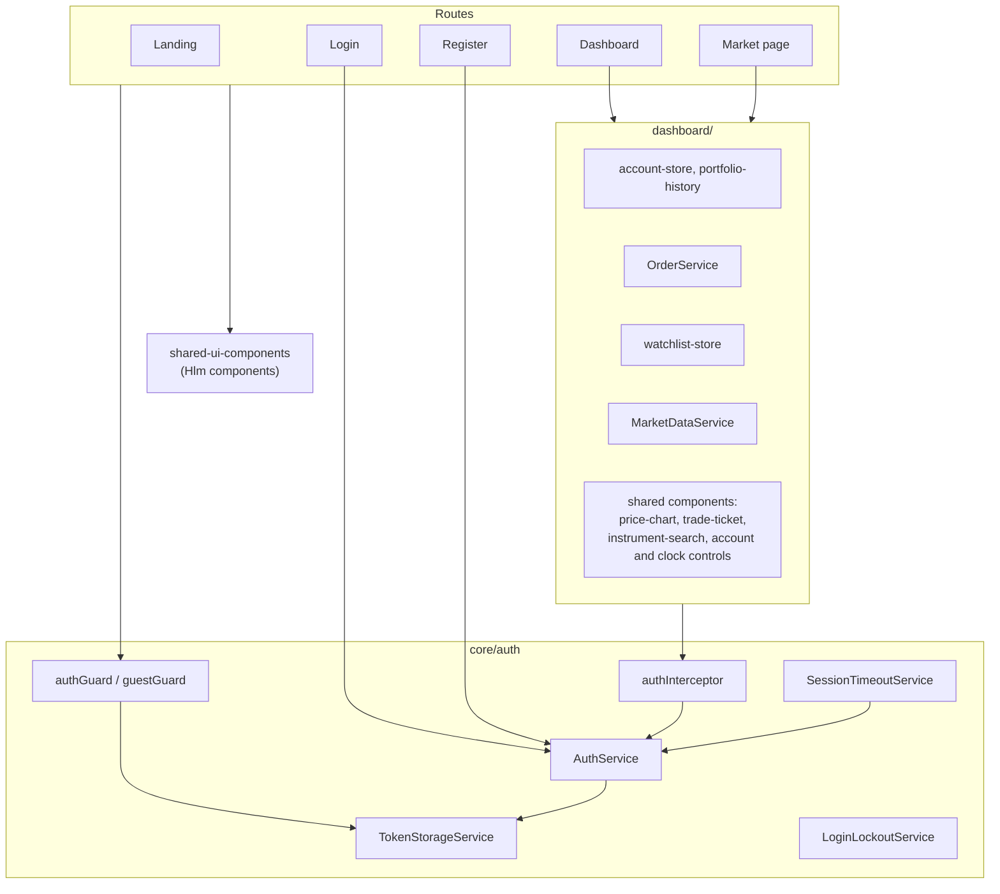
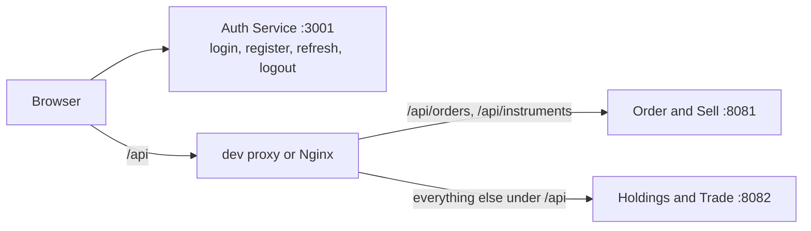
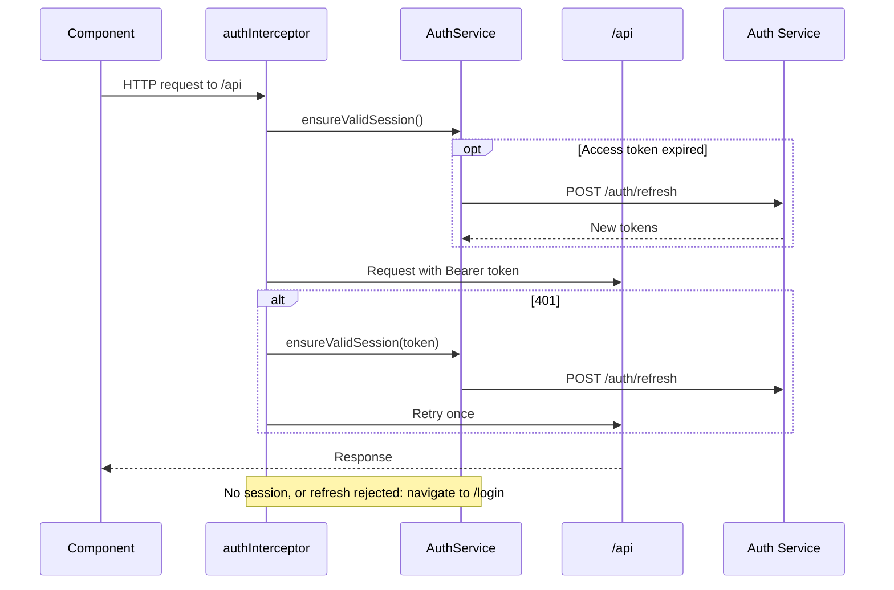

# Client UI

Angular 21 single-page app with standalone components, signals, reactive forms, and OnPush change detection. Server-side rendering runs through the Angular SSR server.

| Route | Guard | Screen |
| --- | --- | --- |
| `/` | none | Landing page |
| `/login`, `/register` | guests only | Sign in and registration |
| `/dashboard` | signed in | Accounts, holdings, portfolio history, watchlist, market ticker, order dialog, recent transactions |
| `/dashboard/markets/:symbol` | signed in | Full-screen instrument page: chart modes and indicators, account and simulation-time controls, order ticket, recent orders |

The market page places the account selector beside the simulation-time control. Its right panel matches the chart column's height on desktop and scrolls internally. Trading is the default tab, with Available Cash and Portfolio Value above Order Execution; Overview, News, AI, and Recent Orders share that panel. Compact cash and portfolio cards sit above the order ticket. The Buy/Sell action sits at the bottom, with flexible space after the estimated cost or proceeds. The account and simulation-time dropdowns and the profile and notification buttons are 46px tall and vertically centered beside the search field and back button. Switching tabs preserves the order draft. Smaller screens stack the chart and tools.

Live prices, candles, and the tick stream come from the Java market API. Metrics, news, and AI commentary on the market page are demo data. Users are signed out after a period of inactivity, 10 minutes by default and configurable in settings.

A user who has not accepted the platform terms in force sees them on the dashboard and on the market page in a dialog that cannot be dismissed, with everything behind it inert. They sign by typing their name and accept, or sign out. The wording and its version are in [terms-content.ts](src/app/dashboard/terms/terms-content.ts); the version must match the one [Holdings and Trade Service](../holdings-and-trade-service/README.md) and [Order and Sell Service](../order-and-sell-service/README.md) have in force, which a test in each of them checks. After changing the wording, run `npm --prefix apps/client-ui run terms:pdf` to regenerate [the PDF](../../docs/pdf/terms-and-conditions.pdf) from it.

## Dua insights

Dua is a 52px circular, viewport-fixed shark launcher at bottom-right on the dashboard and market page, remaining visible while scrolling without reserving layout space. Its compact charcoal panel starts closed. The idle launcher centers the fin in a 2.2x crop of the supplied image. Hover, keyboard focus, a pending notification, or opening chat smoothly reveals the face at 1.35x scale over 450ms. Mouse leave returns to the idle fin crop with the same easing. **Minimize Dua** closes the panel. The preference lasts across screen navigation until logout.

The choice-only panel offers daily movement among the selected account's holdings, position performance versus average cost, and, on the market page, the selected stock's movement and direction across five completed one-minute candles. Results are snapshots labeled with market time; **Refresh** recalculates from available data. Replay changes clear results, incomplete and future candles are excluded, and missing prices are never replaced with purchase cost. Existing demo AI commentary remains separate from Dua.

The exact supplied [shark-launcher-light-512.png](public/assets/assistant/shark-launcher-light-512.png) is served at `/assets/assistant/shark-launcher-light-512.png`. The panel uses the app's charcoal surface tokens, a compact avatar/title header, a back control in results, and stacked choice rows with small cyan icons. A small red **1** badge represents one consolidated pending insight update. Clicking the notification opens chat and clears the badge in one click; hovering reveals the face without acknowledging it. The badge sits 6px below the top of the launcher. Initial data establishes a baseline, and changes to rounded insight results or the trading date trigger the notification without additional requests. Reduced motion disables transitions. No backend, model, text input, persistent chat storage, or trading action is added. See the [MVP design and insight rules](../../docs/dua-insights-mvp-plan.md).

For the MVP, the notification can be acknowledged only once per page load. After the user clicks a notified shark, later price changes, account switches and screen navigation do not restore the badge. A full browser refresh resets this in-memory limit. The chat can still be opened and refreshed normally.

## Architecture



### Request routing



The split is configured twice: [proxy.conf.json](proxy.conf.json) for `ng serve` and [nginx.conf](nginx.conf) for the container image. Add a new backend path to both. The auth service is called directly; its CORS policy allows the dev origin.

### Token renewal



Network and refresh-service failures keep the credentials so the request can be retried; sign-out happens on explicit logout, inactivity, or missing or rejected refresh credentials.

## Loading states

Recent activity rows show order details and plain-text status beneath the transaction label, with the timestamp beneath the amount. Buy, Sell, Deposit and Withdrawal badges appear immediately to the right of the ticker or transaction label, vertically centered on that line. The dashboard and market page share these rows.

The View All transactions table reserves a narrow actions column after Value, keeping order menus separate from prices and aligned across rows. Order menus close when clicking outside them or opening another order's menu.

While data is on its way, the part of the screen that waits for it shows placeholders in the shape of what is coming: pulsing blocks where the figures, rows and charts will be. A figure is not shown as zero, and a list is not shown as empty, until the answer says so.

| Screen | Placeholder | Shown until |
| --- | --- | --- |
| Dashboard | Net worth, allocation and the invested and cash line; the portfolio card; the account menu's label and its accounts; rows of the assets table | The accounts, holdings and cash arrive |
| Dashboard | Rows of Recent Transactions | The orders and the accounts arrive |
| Dashboard | The portfolio chart | The portfolio history of the chosen range arrives |
| Dashboard | Rows of the watch list | The watch list arrives |
| Order dialog | A chart placeholder in a stable chart area; loading, empty and error states keep the same space | The selected instrument's candles arrive |
| Transactions dialog | Rows of the table, when there is nothing to list yet | The full cash ledger arrives |
| Market page | The whole page: summary, chart panel and tools column | The market snapshot arrives |
| Market page | The chart, and each chart of a comparison | Its candles arrive |
| Market page | Available cash, portfolio value, the account menu and the account named above Recent Orders | The accounts arrive |
| Market page | Rows of Recent Orders | The orders and the accounts arrive |

A placeholder is the `skeleton` class in [src/styles.css](src/styles.css), sized with utilities; a list row has its own in [activity-row.component.ts](src/app/dashboard/shared/activity-row.component.ts). The blocks are hidden from assistive technology, and a visually hidden status beside them says what is loading, so a screen reader hears "Loading accounts" as before. The pulse stops under `prefers-reduced-motion`. A load that fails shows its error and retry in place of the placeholder, and a refresh of data already on screen leaves it there. The [Reporting UI](../reporting-ui/README.md#design-system) declares the same class; keep the two alike.

## Commands

client-ui is an independent npm project with its own lockfile. From the repository root:

```sh
npm --prefix apps/client-ui ci
npm --prefix apps/client-ui start
npm --prefix apps/client-ui run build
npm --prefix apps/client-ui test -- --no-watch
npm --prefix apps/client-ui run e2e
```

`ng serve` runs on port 4200 and proxies `/api` as above. Use `--no-watch` for Angular tests; Vitest's `--run` is not supported by the builder.

The production [Dockerfile](Dockerfile) builds the app and serves it through unprivileged Nginx, with SPA fallback and the `/api` proxy.

## Tests

- **Unit**: `*.spec.ts` beside the code under `src`, on the Angular unit-test builder with Vitest. The run fails below 90 percent on statements, branches, functions, or lines (`coverageThresholds` in [angular.json](angular.json)). Add `--coverage` for the report. [vitest.config.ts](vitest.config.ts) uses Vitest 4's `maxWorkers: 1` and disables file parallelism to limit contention with the other Jenkins suites.
- **End-to-end**: Playwright in [e2e](e2e), excluded from the unit-test builder. Install the browser once with `npx --prefix apps/client-ui playwright install chromium`; the suite builds the app and serves it on port 4200 (or reuses a server already there). The auth service and Java backend are replaced by an in-memory [API stand-in](e2e/fixtures/api-stub.ts), so no database or backend is needed. Update the stand-in whenever an auth, account, cash, order, or terms contract changes.

## Shared components

[shared-ui-components](shared-ui-components/README.md) holds the Spartan/Tailwind component library compiled into this app. Only this app consumes it.

## Removing a portfolio account

The three-dot button in the portfolio dropdown opens account settings. Delete Account is the red shared button on the left. It opens a confirmation explaining that the account is archived and its history retained for reporting. Requirements are checked before enabling Delete, and the backend rechecks them atomically. An unmet requirement is displayed next to the action; submission errors retain the confirmation so the user can retry.

Successful deletion refreshes accounts, shared cash, and transactions and selects an available active account. Archived accounts disappear from the client's portfolio selector and active balances. There is no client history section for archived accounts. See the [lifecycle contract](../holdings-and-trade-service/api.md).

## Trading preferences and execution types

Settings > Trading Preferences saves a user-wide 0-10% execution buffer, defaulting to 1%, through the [profile API](../holdings-and-trade-service/api.md#trading-preferences). Both order tickets share the account-style rounded order-type dropdown, initially showing Market. The shares card contains only quantity and its slider. The summary price row shows the market quote for Market orders, an editable price for Limit or Stop orders, and side-by-side Stop and Limit inputs for Stop-Limit orders. The price row keeps a fixed height across order types. The order modal sizes to its ticket content, with a viewport height cap, internal scrolling and opacity-only entrance animation. Preference and chart loading do not reposition the ticket or its submit button. In Edit Order, the graph expands into the removed search bar's space. Editable prices have an external dollar sign, larger text, and an empty-field highlight, with accessible labels. Buffer and reservation calculations remain internal to the ticket without extra helper text. Market uses the submission quote and Stop uses its first triggering quote with the saved buffer; Limit and Stop-Limit respect explicit limits. The server captures its own submission quote. Order placement and later fills use success toasts for all execution types. Recent activity and transaction history display entered conditional prices (both Stop and Limit for Stop-Limit), retaining actual prices for fills. Open orders offer a three-dot menu beside the amount or price, spanning the transaction row height, with Edit order reopening the stock ticket and Cancel order using centered confirmation. Edits prefill the original quantity/type/prices and retain the account, stock and side; saving atomically replaces the order. Accepted/Open status uses blue styling. These actions are available in recent activity and transaction history. Open orders expire at their submission simulation day's Chicago market close. Expired orders appear as Cancelled in recent activity without an expiry suffix or explanation. Buying power and sellable shares exclude reservations; valuations retain total balances.

Market chart indicators start at the first available candle, using available history until their full period is reached. SMA, EMA and Bollinger Bands use up to 20 candles; RSI uses up to 14 price changes and starts at a neutral 50. Latest appears at the top right beside enabled indicator labels when the chart is away from the latest bars, including both comparison charts.

Each comparison chart places its ticker, price, USD dollar change, signed percentage change, chart controls and Latest in one header row above the plot, wrapping only when space requires it. Comparison mode hides the active indicator badges while keeping their chart overlays and RSI enabled.
