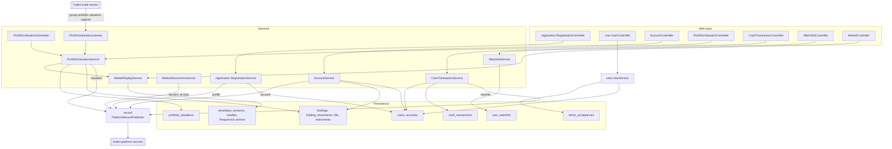
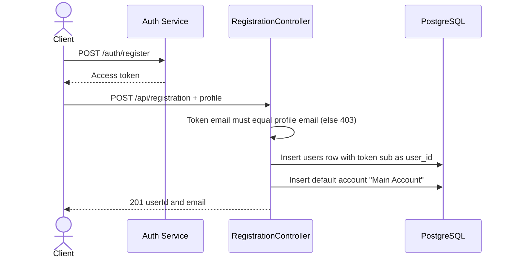
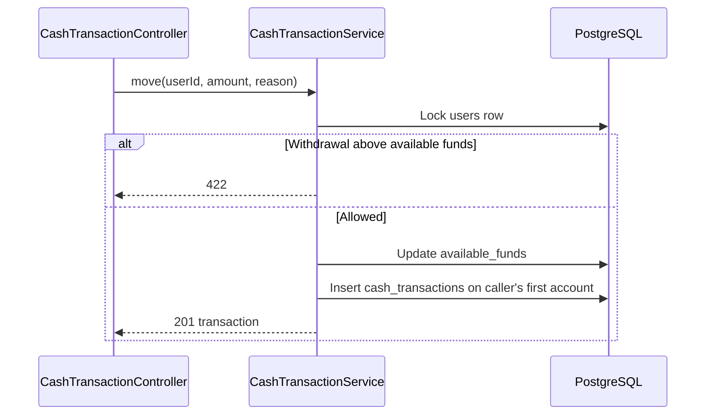
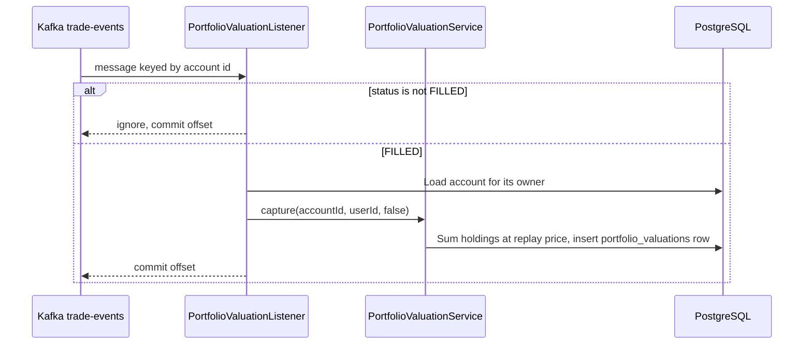
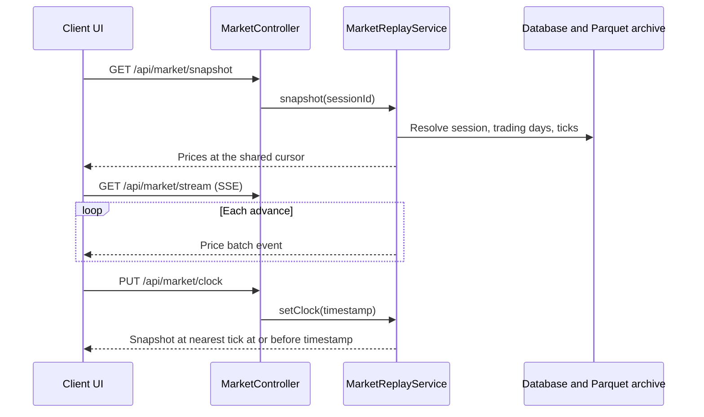

# Holdings and Trade Service

Spring Boot (Java 21) service for the signed-in user's own data: profile, accounts, holdings, shared cash, saved watchlist, and portfolio value history. It also serves the simulated market feed. Order submission and execution belong to the [Order and Sell Service](../order-and-sell-service/README.md).

- Port 8082, Swagger UI at http://localhost:8082/swagger-ui.html
- Compiles source it shares with the Order and Sell Service from [packages/trading-java-common](../../packages/trading-java-common/README.md): the market feed, token verification wiring, and the base classes its entities extend.
- Shares the `trading_season` database. The schema comes from [db/migrations](../../db/migrations); Hibernate never alters it.
- Authenticates callers by verifying RS256 tokens from the [Auth Service](../auth-service/README.md) against its cached JWKS. Every user-specific endpoint resolves the owner from the token's `sub`; no path or body field can name another user. An account that belongs to someone else is 403 and a missing one is 404.
- Runs the `portfolio-valuation-capture` Kafka consumer group on `trade-events`: when an order fills, it records a portfolio valuation for that account, so the portfolio chart gets a point at the moment of the trade even with no dashboard open.
- Publishes each profile, account, deposit and withdrawal it writes, the portfolio valuations reporting needs, and the current simulation session to the Kafka `platform-records` topic. The Reporting Service has no database connection: that topic is how it knows who the customers are. See [What reporting receives](#what-reporting-receives).

## Endpoints

All require a bearer token except where marked public.

| Method | Path | Purpose |
| --- | --- | --- |
| POST | `/api/registration/account-exists` | Whether an email is registered (public) |
| POST | `/api/registration` | Create the caller's profile and a default account |
| GET | `/api/users/me` | The caller's profile, without the SSN; `termsAccepted` reports whether they accepted the platform terms in force |
| PUT | `/api/users/me/terms-acceptance` | Record that the caller accepts the platform terms; returns the updated profile |
| GET, POST | `/api/me/accounts` | List (newest first) or open an account |
| PUT | `/api/me/accounts/{accountId}` | Rename an owned account |
| GET | `/api/accounts/{accountId}` | An owned account |
| GET | `/api/accounts/{accountId}/holdings` | Positions with symbol and average cost |
| GET | `/api/accounts/{accountId}/portfolio-history` | Value observations; `timeframe` is `1D`, `5D`, `1W`, `1M`, or `1Y` |
| POST | `/api/accounts/{accountId}/portfolio-valuations` | Record a server-calculated value now |
| GET, POST | `/api/me/cash-transactions` | List or record a deposit or withdrawal |
| GET | `/api/me/watchlist` | The caller's saved stocks |
| PUT, DELETE | `/api/me/watchlist/{symbol}` | Save or remove a stock |
| GET | `/api/market/snapshot`, `/candles`, `/stream` | Public market data (snapshot, OHLCV candles, SSE ticks) |
| PUT | `/api/market/clock` | Move the shared replay cursor (authenticated) |

Behavior worth knowing:

- Registration needs a bearer token whose `email` matches the profile email, a nonblank name and address, SSN as `NNN-NN-NNNN`, a past date of birth, `traderLevel` of `BEGINNER`, `INTERMEDIATE`, or `ADVANCED`, and `availableFunds` of at least 5000.00. Credentials are created first with the Auth Service; this service never sees a password.
- Accepting the terms takes `{"termsVersion": "..."}`, the version the client displayed. A version other than the one in force (`UserService.CURRENT_TERMS_VERSION`) is 409, so an acceptance is never recorded against wording the user did not see. Each acceptance is one `terms_acceptances` row; accepting again keeps the first row and its time. Changing the version makes every profile report `termsAccepted: false` until its owner accepts again.
- Cash belongs to the user, not the account: every account shares `users.available_funds`. Each deposit or withdrawal updates that balance and appends a `cash_transactions` row in one transaction with the user row locked. A withdrawal above the balance is 422.
- A holding's `averageCost` is derived by replaying `holding_movements` and `fills` oldest first as a moving weighted average. This service never writes those tables.
- Portfolio history is recorded once a minute for eligible accounts, by the Kafka consumer when an order fills, and on request from the UI after a fill; captures within the same minute are coalesced. Value is held quantity times replay price, falling back to average cost; cash is excluded.
- Candles come from the seeded one-minute data and are capped at 500 points. The stream keeps 30 events for `Last-Event-ID` reconnection and then asks the client to reload the snapshot.
- Errors use `{"error": "..."}`.

## Design



### Registration



### Cash movement



### Portfolio valuation on fill



The listener resolves the owner from the account row, not from a token, because there is no caller. A failed capture is logged and the offset is still committed, so one bad message never blocks the group. Replaying offsets only adds chart points.

A message carrying a `replay` header is an old fill published again for reporting by [db/tools/republish_history.py](../../db/README.md#reporting-feed-tools). The holdings did not change when it arrived, so the listener records nothing for it.

### What reporting receives

The Reporting Service reads Kafka, not the database. Each service method that writes a row reporting shows raises a record inside its transaction, and `PlatformRecordPublisher` sends it to the `platform-records` topic once the transaction has committed, keyed by record type and id so the compacted topic keeps the latest state of every row. A send failure is logged and never fails the write.

| Record | Raised when | Key | Body |
| --- | --- | --- | --- |
| `CUSTOMER_PROFILE` | A profile is registered | `CUSTOMER_PROFILE:<userId>` | `userId`, `firstName`, `lastName`, `traderLevel`, `availableFunds`, `sessionTimeoutMinutes`, `lastActivityAt`, `createdAt`, `asOf` |
| `TRADING_ACCOUNT` | An account is opened or renamed | `TRADING_ACCOUNT:<accountId>` | `accountId`, `userId`, `name`, `openedDate`, `currency` |
| `CASH_TRANSFER` | A deposit or withdrawal is booked | `CASH_TRANSFER:<cashTransactionId>` | `cashTransactionId`, `accountId`, `userId`, `amount`, `reason`, `createdAt`, and the `availableFunds` it left |
| `PORTFOLIO_VALUATION` | A valuation is captured | `PORTFOLIO_VALUATION:<accountId>` | `valuationId`, `accountId`, `observedAt`, `portfolioValue` |
| `MARKET_SESSION` | The service has started | `MARKET_SESSION:current` | `sessionId`, the newest completed simulation session |

Every body also carries its `type`. An SSN, address, date of birth or middle name is never part of one.

The scheduler values every account every minute, which is more than reporting needs. A valuation captured for a fill or a dashboard is always published; a scheduled one is published at most once per account per `app.events.valuation-interval-minutes` (default 15). A valuation is keyed by its account, so a newer one replaces an older one in the topic.

### Market replay



Parquet-backed sessions read raw ticks from the archive: `MARKET_REPLAY_ARCHIVE_LOCATION` first, then the location recorded at import, then the matching archive under `apps/market-data/db/seeds`. A missing partition returns an unavailable error rather than falling back to one-minute candles.

## Configuration

Environment variables override [application.properties](src/main/resources/application.properties).

| Variable | Default | Purpose |
| --- | --- | --- |
| `SPRING_DATASOURCE_URL` | `jdbc:postgresql://localhost:5432/trading_season` | Database |
| `SPRING_DATASOURCE_USERNAME` | `trading_season` | Database user |
| `SPRING_DATASOURCE_PASSWORD` | `changeme` | Database password |
| `AUTH_JWK_SET_URI` | `http://localhost:3001/.well-known/jwks.json` | Auth service public keys |
| `AUTH_JWT_ISSUER` | `https://auth.dualeapa.local` | Required `iss`, must equal the auth service's `JWT_ISSUER` |
| `CORS_ORIGINS` | `http://localhost:4200` | Allowed browser origins, comma-separated |
| `MARKET_REPLAY_ARCHIVE_LOCATION` | empty | Absolute path to the Parquet archive |
| `KAFKA_BOOTSTRAP_SERVERS` | `localhost:29092` | Broker for the `trade-events` consumer and the `platform-records` publisher; Compose sets `kafka:9092` |

The property `app.events.enabled` (default `true`) registers the `portfolio-valuation-capture` consumer and the `platform-records` publisher; the test profile sets it to `false` so contexts without a broker never contact one. `app.events.valuation-interval-minutes` (default 15) is the least time between two scheduled valuations of one account that are published. Without a broker the service still starts, but a write that publishes then waits up to five seconds (`max.block.ms`) before responding.

## Run and test

Start a migrated database with market data ([db/README.md](../../db/README.md), [apps/market-data](../market-data/README.md)), the auth service, and the Kafka broker with its topics from the Compose file (`docker compose -f infrastructure/docker-compose/docker-compose.local.yml up -d kafka-init`), then:

```sh
mvn spring-boot:run
mvn test
```

Tests use H2 with [application-test.properties](src/test/resources/application-test.properties), mirror the source packages under `src/test/java/app`, and cover cross-user isolation for every user-specific endpoint. The valuation-capture flow test starts an embedded Kafka broker; no external broker is needed. Use `@SpringBootTest` with `@Transactional` for repository tests; `@DataJpaTest` is not available. JaCoCo fails the build below 85 percent on every counter in any package (`coverage.minimum` in [pom.xml](pom.xml)); reports are in `target/site/jacoco/`.

Keep HTTP validation in controllers, business logic in services, and persistence in repositories. After changing Java code, regenerate the Javadocs; see [AGENTS.md](../../AGENTS.md).
