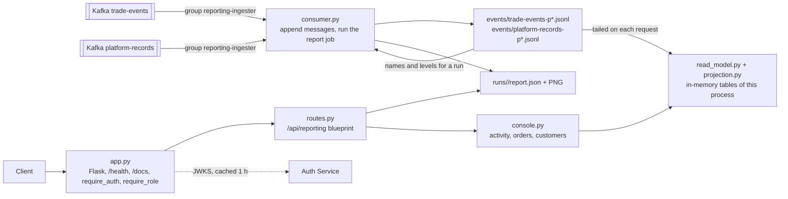

# Reporting Service

Python Flask service with two jobs. It turns the `trade-events` Kafka topic into scheduled reports, for analysts and admins, and it serves read-only views of platform activity, orders and customers for the [Reporting UI](../reporting-ui/README.md)'s console, for admins only.

It reads Kafka and nothing else. It has no connection to the `trading_season` database, no driver to open one with, and no setting that names it, so nothing it does can compete with trading for the database.

- Port 8083, Swagger UI at http://localhost:8083/docs, OpenAPI at `/openapi.yaml`
- Served by Gunicorn in Docker. The [Reporting UI](../reporting-ui/README.md) presents the runs; it calls this service through its own origin, so it needs no entry in `CORS_ORIGINS`.

## How it works

1. The trading services publish what they commit to two topics. Order and Sell publishes one `trade-events` message per committed order status change (`ACCEPTED`, `FILLED`, `REJECTED`), keyed by account id, carrying the order row and, for a fill, the fill and its two ledger postings. The auth service and both Java services publish the current state of every other row reporting shows to `platform-records`; see [what arrives](#what-arrives).
2. `consumer.py`, consumer group `reporting-ingester`, appends each message of either topic as one JSON line to `events/<topic>-p<partition>.jsonl` under `REPORTING_FILES_DIR`, then commits the offset. Offsets already on disk are skipped, so redelivery never duplicates a line.
3. When it starts, and then every `SCHEDULER_INTERVAL_MINUTES`, the same process runs `report_run.py`: reads the `trade-events` files, takes account and trader names and each trader's level from the read model, and writes `runs/<UTC timestamp>/report.json` plus four PNG charts. `runs/latest` points at the new run; older runs are deleted. The first run reports the events already on disk, so a restart serves a report at once; a run that comes due while the process is busy runs late instead of being skipped. The charts use the Reporting UI's dark surface and colors, filled orders in the gain color and rejected orders in the loss color.
4. The web service (`wsgi.py` under gunicorn) serves the runs and the console behind the same RS256 tokens the Java services accept.

### The read model

The console's queries need tables, and the service has no database to keep them in, so each process builds its own. [read_model.py](read_model.py) holds the tables of [models.py](models.py) in an in-memory SQLite database and fills them from the event files: the first request reads every line, and each later one reads only what the consumer has appended since, so a message is in the console within seconds of being published. [projection.py](projection.py) turns each message into rows as an upsert keyed by the row's own id, so a message applied twice, or the whole history replayed, leaves the same rows.

The tables are shaped like the trading tables the messages describe, which is why [console.py](console.py) reads the way it would against the real ones. They hold only what was published: there is no column for a password hash, SSN, address or date of birth.

Three values can be reported by more than one message, and a replay or the other topic may deliver an older one later. Each keeps a mark that decides which wins:

| Value | Reported by | Rule |
| --- | --- | --- |
| An order's status | Each of its status events | Never moves backwards: `PENDING`, `ACCEPTED`, then `FILLED` or `REJECTED` |
| A trader's cash | A profile, a transfer, a fill | The balance with the latest timestamp, kept in `funds_balances` |
| A holding | Each fill of that account and instrument | The quantity the highest movement id left |

Nothing in the read model is the only copy of anything: the files are its source, and if one is replaced or removed the tables are emptied and rebuilt from what is on disk.

### What arrives

| Topic | Message | Published by | Becomes |
| --- | --- | --- | --- |
| `trade-events` | An order status, with `order` (the order row) and, when filled, `execution` (the fill, the cash posting, the holding movement, and the balances they left) | Order and Sell | `orders`, `instruments`, `fills`, `cash_transactions`, `holding_movements`, `holdings`, the trader's cash |
| `platform-records` | `SIGN_IN` | Auth Service | `user_accounts`: email, role, failed attempts, lock |
| `platform-records` | `CUSTOMER_PROFILE` | Holdings and Trade | `users`: name, trader level, cash |
| `platform-records` | `TRADING_ACCOUNT` | Holdings and Trade | `accounts`: the account and its owner |
| `platform-records` | `CASH_TRANSFER` | Holdings and Trade | `cash_transactions`: a deposit or withdrawal, and the trader's cash |
| `platform-records` | `PORTFOLIO_VALUATION` | Holdings and Trade | `portfolio_valuations`: the newest value per account |
| `platform-records` | `ORDER_AUDIT` | Order and Sell | `audit_trail` |
| `platform-records` | `MARKET_SESSION` | Holdings and Trade | `simulation_sessions`: the session prices are replayed from |

A `platform-records` message is the current state of one row, keyed `<TYPE>:<id>`, and the topic is compacted, so it always holds the latest state of every row however old.

History that predates these publishers, or that was written by SQL instead of by a service, never reached the topics. [db/tools/republish_history.py](../../db/README.md#reporting-feed-tools) publishes it, once, from the database; this service still only reads Kafka.

### Report runs

A run holds the three views the business asked to analyse trading by (BR-16: instrument, period and client segment) and a count per account, none of which touches the live trading path:

| View | In `report.json` | Chart |
| --- | --- | --- |
| By instrument | `volumeBySymbol`: fills, shares and notional per symbol | `volume_by_symbol.png` |
| By period | `dailyCounts`: filled and rejected orders per UTC day | `daily_trades.png` |
| By client segment | `activityBySegment`: active accounts, fills, rejections and notional per trader level | `volume_by_segment.png` |
| By account | `tradesPerAccount`: resolved orders per account | `trades_per_account.png` |

The run counts only final statuses as trades, and counts each order's status once: when history is republished, an order already on disk arrives again under a new offset and replaces its earlier message instead of adding to a count.

A client segment is a trader's level: `BEGINNER`, `INTERMEDIATE` or `ADVANCED`, the only classification of clients the product keeps. A trader counts under the level they hold when the run is made, whatever it was when they traded. Orders of an account no published record names are counted under `UNKNOWN`.

### Console

The console endpoints are the other half, served to admins only because they show individual customers and their orders. [console.py](console.py) queries the read model, filtering in SQL and aggregating in Python.

| View | Read model tables |
| --- | --- |
| Activity: figures against the prior period, notional over time, status split, split by client segment, newest events, most traded symbols | `orders`, `fills`, `cash_transactions`, `user_accounts`, `users`, `accounts`, `instruments`, `simulation_sessions` |
| Orders with the deposits and withdrawals beside them, and one order with its ledger impact and audit trail | the above, plus `holdings`, `holding_movements`, `audit_trail` |
| Customers, and one customer with balances, orders and transfers | `user_accounts`, `users`, `accounts`, `portfolio_valuations`, and the order tables |

- A range is the viewer's own days: the UI sends its offset from UTC, and "today" starts at the viewer's midnight. Each figure is compared with the period of equal length just before the range.
- The range `all` starts on the day of the first order or cash transfer in the read model, or today when there is none. Nothing comes before it, so every change is null. Its chart has a point per day for a history of up to 366 days; beyond that each point covers a whole number of days, enough of them to stay within 366 points.
- Activity is split by client segment the same way a run is: by trader level, as each trader holds it now. It counts the traders of a level who placed an order in the range, their orders and the notional filled.
- Orders, transfers and the feed are newest first by when they happened, not by id, so history loaded late sorts where it belongs.
- Cash and holdings before and after an order are worked back from today's balance by removing every posting made after the order's own.
- A customer is a sign-in with the `TRADER` role. Analysts and admins are staff: they are left out of the customer list and answered 404 as a customer.
- A transfer is a `cash_transactions` row whose reason is `DEPOSIT` or `WITHDRAWAL`. What an order's fill posted to cash is part of that order, not a transfer.
- A customer is `LOCKED` while their sign-in's `locked_until` is in the future. Password hashes, SSNs, addresses and dates of birth are never published, so they cannot be returned.
- Nothing here writes anywhere but the service's own files. An admin cannot unlock an account from reporting.

## Technology

- Python 3.14, Flask 3, Flask-SQLAlchemy over the in-memory SQLite that ships with Python; no database driver is installed
- confluent-kafka for the consumer, APScheduler for the report job, matplotlib (Agg) for charts
- gunicorn for the web service; one image, two processes

## Local development

Prerequisites: Python 3.14, the Compose stack's Kafka (`docker compose ... up -d kafka-init`), and the auth service for tokens. No database.

```sh
python -m venv venv
source venv/bin/activate          # Windows: venv\Scripts\activate
pip install -r requirements.txt
cp .env.example .env              # adjust KAFKA_BOOTSTRAP_SERVERS if needed
python consumer.py                # terminal 1: consumer plus report scheduler
FLASK_ENV=development python app.py   # terminal 2: web service on 8083
```

On the host the broker is `localhost:29092` and the files land in `./data/reporting` (ignored by git). Run exactly one consumer at a time.

On Windows, [scripts/start-local.ps1](../../scripts/start-local.ps1) starts both processes from this `venv` with the rest of the stack, and can start a broker without Docker; see [Local processes](../../README.md#local-processes-windows).

## Endpoints

Authenticated endpoints need an RS256 bearer token from the [Auth Service](../auth-service/README.md). The run and console endpoints cover every account on the platform, so they also need a role in the token's `roles` claim, and a valid token without it is answered 403. The run endpoints accept `ANALYST` or `ADMIN`. The console endpoints accept `ADMIN` only, because they show individual customers and their orders. The profile is the caller's own and needs only a valid token.

| Method | Path | Access | Purpose |
| --- | --- | --- | --- |
| GET | `/` | public | Service information and entry points |
| GET | `/health` | public | Liveness, and that the read model can be brought up to date from the event files |
| GET | `/docs`, `/openapi.yaml` | public | Swagger UI and the OpenAPI contract |
| GET | `/api/reporting/profile` | any token | The caller's trader profile |
| GET | `/api/reporting/runs` | `ANALYST`, `ADMIN` | Every complete report run, newest first, with the latest run id |
| GET | `/api/reporting/runs/latest` | `ANALYST`, `ADMIN` | The latest run's `report.json`; 404 until the first run |
| GET | `/api/reporting/runs/{runId}/files/{name}` | `ANALYST`, `ADMIN` | One PNG chart of a run |
| GET | `/api/reporting/scheduler/status` | public | Latest run id, when it was generated, and the interval |
| GET | `/api/reporting/activity?range=&tzOffset=` | `ADMIN` | Platform activity over `today`, `7d`, `30d`, `90d` or `all`, in the viewer's days |
| GET | `/api/reporting/orders?limit=` | `ADMIN` | The newest orders across every account, 500 unless `limit` says otherwise (1 to 1000), and the newest deposits and withdrawals under the same limit |
| GET | `/api/reporting/orders/{orderId}` | `ADMIN` | One order with its execution, ledger impact and audit trail |
| GET | `/api/reporting/customers` | `ADMIN` | Every trader with their balances and lock status; analysts and admins are left out |
| GET | `/api/reporting/customers/{userId}` | `ADMIN` | One customer with their accounts, orders and transfers; 404 for an analyst or admin |

[openapi.yaml](openapi.yaml) is the canonical contract. Keep it, [routes.py](routes.py), [app.py](app.py), and the tests in step.

## Design



No arrow leaves this diagram for the trading database, because the service has none.

## Configuration

| Variable | Default | Purpose |
| --- | --- | --- |
| `AUTH_SERVICE_URL` | `http://localhost:3001` | JWKS source for token verification |
| `AUTH_JWT_ISSUER` | `http://localhost:3001` | Expected `iss` claim; must equal the auth service's issuer |
| `CORS_ORIGINS` | `http://localhost:4200` | Allowed browser origins, comma-separated |
| `REPORTING_FILES_DIR` | `./data/reporting` (host), `/data/reporting` (image) | Event files and report runs: all the data the service has |
| `KAFKA_BOOTSTRAP_SERVERS` | `localhost:29092` | Broker; Compose sets `kafka:9092` |
| `KAFKA_TRADE_EVENTS_TOPIC` | `trade-events` | The order status topic to consume |
| `KAFKA_PLATFORM_RECORDS_TOPIC` | `platform-records` | The records topic to consume |
| `REPORTING_CONSUMER_GROUP` | `reporting-ingester` | Consumer group; keep it stable so offsets carry across restarts |
| `SCHEDULER_ENABLED` | `True` | Run the report job; the web service is started with `false` |
| `SCHEDULER_INTERVAL_MINUTES` | `15` | Report run interval, after the run the consumer makes when it starts |

There is no database variable. A `DATABASE_URL` in the environment is ignored.

## Files on the volume

```
<REPORTING_FILES_DIR>/
  events/trade-events-p0.jsonl       # one line per order status: partition, offset, accountId, orderId, status,
  events/trade-events-p1.jsonl       #   symbol, side, quantity, price, rejectionReason, occurredAt, order, execution
  events/trade-events-p2.jsonl
  events/platform-records-p0.jsonl   # one line per record: partition, offset, key, type, and the record's fields
  events/platform-records-p1.jsonl
  events/platform-records-p2.jsonl
  runs/<YYYYMMDDTHHMMSSZ>/report.json, volume_by_symbol.png, daily_trades.png, volume_by_segment.png,
                           trades_per_account.png
  runs/latest                        # the current run id
```

The files are named for what they hold, whatever name a deployment gives the topics.

Everything here is derived from the topics. To rebuild: stop the consumer, delete the directory contents, reset the group's offsets to earliest for both topics (`kafka-consumer-groups.sh --group reporting-ingester --all-topics --reset-offsets --to-earliest --execute`), start the consumer. `platform-records` is compacted and keeps every row's latest state, so it always replays in full. `trade-events` keeps messages for the broker's retention period only; orders older than that come back by running [republish_history.py](../../db/README.md#reporting-feed-tools) again.

## Tests

```sh
pytest
```

Tests run on the same in-memory read model the service uses, a temporary files directory and a fake Kafka source. No broker, database or Docker is needed. Coverage is reported through `pytest-cov` (see `pytest.ini`).

## Docker

The image runs gunicorn by default; Compose starts a second container from the same image with `command: ["python", "consumer.py"]`. Both mount the `reporting_files` volume at `/data/reporting`, the web service read-only. Neither depends on the database container. The consumer is a separate container rather than a thread in the web app because gunicorn runs several worker processes, and the consumer must run exactly once: one writer per partition file and one scheduler. Same code, same image, a different command; nothing is duplicated. See [Local Compose](../../infrastructure/docker-compose/docker-compose.local.yml).

## Known limitations

- Portfolio performance measures (returns, drawdown, Sharpe) are not computed yet; the run produces volume, activity and fill/rejection insights.
- A trader's level is not kept over time, so a segment is always today's level: a trader who was promoted takes their earlier orders with them into the new segment.
- The console is as current as the topics. A message is visible within seconds of being published, but a portfolio value can be up to 15 minutes old: Holdings and Trade values every account each minute and publishes a scheduled valuation at most that often, while a valuation captured for a fill is published at once.
- Each web worker holds the whole read model in memory and builds it when it first needs it, by reading every stored message: a few thousand a second. That suits a simulation's volume; a much larger history would want a snapshot to start from.
- The console aggregates in Python, loading the orders of twice the chosen range per request, and one request at a time per worker uses the tables.
- The quote an order executed against is not published, so an order shows its indicative price, price buffer and slippage in place of bid, ask and spread.
- An order appears once its account and its owner's profile have been published. Rows written by SQL are in neither topic until they are republished.
