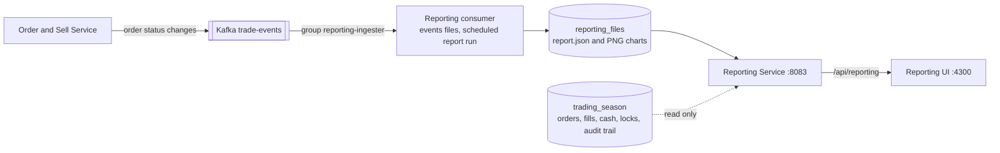
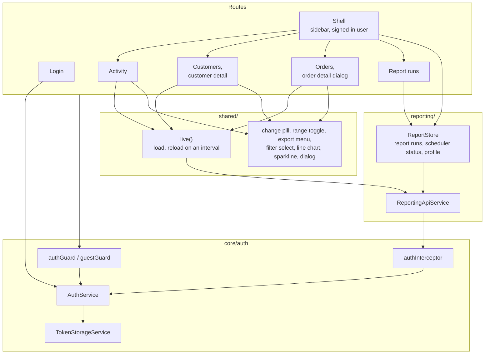
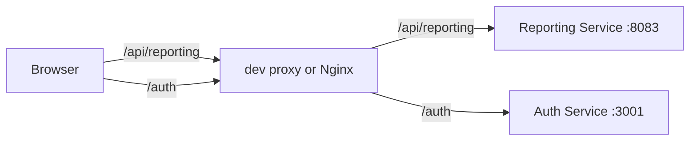

# Reporting UI

Angular 21 single-page app for analysts who watch platform activity and support customers. It presents what the [Reporting Service](../reporting-service/README.md) serves: activity, customers and orders read from the trading database, and the report runs the reporting consumer builds from the `trade-events` Kafka topic. Standalone components, signals, reactive forms, and OnPush change detection, with no server-side rendering.

- Port 4300, for both `ng serve` and the Compose container
- For analysts only. It signs in against the [Auth Service](../auth-service/README.md) and admits an account only if its token carries the `ANALYST` [role](../auth-service/README.md#roles). It has no registration screen. In development, sign in as `analyst@example.com` / `analyst123`.
- Read only. Nothing in it changes an account or an order.

| Route | Guard | Screen |
| --- | --- | --- |
| `/login` | anyone not signed in as an analyst | Sign in |
| `/` | signed-in analyst | Activity: a range toggle, five headline figures against the prior period, notional traded over time, orders by status, the newest events, most traded symbols |
| `/customers` | signed-in analyst | Customers: every sign-in with status, accounts, cash, portfolio, failed sign-ins and last activity; search and filters |
| `/customers/:userId` | signed-in analyst | One customer: profile, sign-in security, balances, and their orders |
| `/orders` | signed-in analyst | Orders: every order with search and filters; a row opens the order with its execution, ledger impact and audit trail |
| `/runs` | signed-in analyst | Report runs: the runs on disk and the PNG charts of the selected run, with download |

Every figure on screen comes from the Reporting Service. Nothing is demo data. Times are shown in the viewer's time zone, and a range such as Today is the viewer's own day. The days inside a report run are UTC days, as the report job buckets them.

## How the data reaches the screen



The UI never talks to Kafka or the database. Two kinds of data reach it, both through the Reporting Service:

| Screen | Source | Endpoint | Kept fresh by |
| --- | --- | --- | --- |
| Activity | Database | `GET /api/reporting/activity?range=&tzOffset=` | Reading again every 15 seconds, and when the range changes |
| Customers | Database | `GET /api/reporting/customers` | Reading again every 30 seconds |
| One customer | Database | `GET /api/reporting/customers/{userId}` | Reading again every 30 seconds |
| Orders | Database | `GET /api/reporting/orders` | Reading again every 30 seconds |
| One order | Database | `GET /api/reporting/orders/{orderId}` | Read when the order is opened |
| Report runs | `trade-events` files | `GET /api/reporting/runs`, `GET /api/reporting/runs/latest`, `GET /api/reporting/scheduler/status` | Asking the scheduler status every 30 seconds and reloading when the latest run id changes |
| Chart images of a run | `trade-events` files | `GET /api/reporting/runs/{runId}/files/{name}`, fetched as a blob because an image tag cannot send the bearer token | Loaded with the run |
| Signed-in user's name and trader level | Database | `GET /api/reporting/profile`; a sign-in without a trading profile (404) shows its email instead | Read once |

A refresh that fails leaves the last good data on screen. The database screens show orders whether or not a Kafka broker was running when they were placed; the report runs show only orders placed while one was.

## Architecture



`ReportStore` is provided by the shell component, so it exists only while a signed-in screen is shown and its polling stops on sign-out. Each database screen owns its data through `live()`, which stops with the screen.

### Request routing



Both backends are called on the UI's own origin, so neither needs a CORS entry for port 4300. The split is configured twice: [proxy.conf.json](proxy.conf.json) for `ng serve` and [nginx.conf](nginx.conf) for the container image. Add a new backend path to both. This differs from the Client UI, which calls the Auth Service directly.

Token handling matches the Client UI: the interceptor adds the bearer token to `/api/reporting` calls, refreshes an expired access token through `POST /auth/refresh`, retries once after a 401, and sends the user to `/login` when the refresh token is missing or rejected. The session is kept in `localStorage` under its own key, separate from the Client UI's because the two apps are different origins.

### Analyst access

The Reporting Service is what enforces the rule: it answers 403 on every run and console endpoint to a token without the `ANALYST` role. The UI checks the same claim so that nobody else gets a screen that could only show errors:

| Moment | What happens to an account that is not an analyst |
| --- | --- |
| Sign-in | The credentials are accepted by the Auth Service, the UI revokes that session at once, keeps no token, and says the account has no access to reporting |
| Opening a screen with a stored session | The route guard signs it out and returns to `/login` with the same message |
| A 403 from the Reporting Service, for example after a refresh issued a token for a changed role | The interceptor signs it out and returns to `/login` with the same message |

A role change takes effect at the account's next sign-in or token refresh. See [roles](../auth-service/README.md#roles) for how an account becomes an analyst.

## Design system

The screens reproduce the TradingSeason design system's reporting console: the sidebar shell, Activity, Customers, the customer page, Orders and the order dialog, with the kit's layout, spacing, type and copy. The design system export itself is not checked in.

The tokens are declared in [src/styles.css](src/styles.css) with the same values as the Client UI's dark theme, and Tailwind v4 maps them to utilities. Text takes the font's own line height, as the kit does. The kit's components are ported once, in [src/app/shared](src/app/shared):

| Kit component | Here |
| --- | --- |
| ChangePill, status tags | [change-pill.component.ts](src/app/shared/change-pill.component.ts) |
| TimeframeToggle | [timeframe-toggle.component.ts](src/app/shared/timeframe-toggle.component.ts) |
| HeaderDropdown with the export menu | [export-menu.component.ts](src/app/shared/export-menu.component.ts): CSV of the rows on screen, or PDF through the print dialog |
| Select with a caption | [filter-select.component.ts](src/app/shared/filter-select.component.ts) |
| PriceChart | [line-chart.component.ts](src/app/shared/line-chart.component.ts) |
| Sparkline | [sparkline.component.ts](src/app/shared/sparkline.component.ts) |
| Dialog | [dialog.component.ts](src/app/shared/dialog.component.ts) |
| DashCard, DashLabel, DashLink, Button, Input, table head and rows | Classes in [src/styles.css](src/styles.css): `dash-card`, `net-worth-card`, `dash-label`, `dash-link`, `ghost-button`, `ds-control`, `dash-table-head`, `row-button` |

From 1024px wide a screen fills the window and its lists scroll inside their cards, with a bottom fade and no scrollbar, as the kit draws it. Narrower, or on a short window, the page scrolls.

The kit is a proposal drawn on sample data. Where the product has no such data, or the screen must stay read only, the app departs from it:

| Kit | Here | Why |
| --- | --- | --- |
| "Unlock now" on a locked customer, "Email customer" | Left out; the lock banner says when the account unlocks | Reporting only reads |
| Statuses FILLED, PENDING, REJECTED, CANCELLED, and customer status SUSPENDED | FILLED, PENDING, ACCEPTED, REJECTED; ACTIVE and LOCKED | These are the statuses the product has |
| Order execution: bid and ask at submit, spread, market price now, session | Indicative price, price buffer, slippage, submitted, resolved, market time | The quote an order executed against is not kept in the database |
| "Streaming" beside Live activity | "Live" | The feed is read again every 15 seconds, not streamed |
| Three sidebar entries | A fourth, Report runs | The scheduled reports built from the Kafka topic are a product requirement the kit predates |
| No way to sign out | A log out button beside the signed-in user | The kit does not draw one |
| Most traded shows a price sparkline under "Today" whatever the range | The column is named after the chosen range and plots the symbol's fill prices in it | The label follows what is plotted |

The chart images on the Report runs screen are drawn by the Reporting Service, in the same surface and colors.

This app does not use the Client UI's [shared-ui-components](../client-ui/shared-ui-components/README.md). Its own markup is styled directly from the tokens, so that library still has one consumer.

## Commands

reporting-ui is an independent npm project with its own lockfile. From the repository root:

```sh
npm --prefix apps/reporting-ui ci
npm --prefix apps/reporting-ui start
npm --prefix apps/reporting-ui run build
npm --prefix apps/reporting-ui test -- --no-watch
```

`ng serve` runs on port 4300 and expects the Auth Service on `localhost:3001` and the Reporting Service on `localhost:8083`; [scripts/start-local.ps1](../../scripts/start-local.ps1) starts all three, see [Local processes](../../README.md#local-processes-windows). Use `--no-watch` for the tests; Vitest's `--run` is not supported by the builder.

What the screens show depends on what is running:

| Situation | Activity, Customers and Orders | Report runs |
| --- | --- | --- |
| Reporting Service not reachable | A load error with a retry | A load error with a retry |
| Reporting Service up, consumer never started | Everything in the database | "No report runs yet" |
| Consumer running, no trade event stored yet | Everything in the database | A report of zeros |
| Orders placed while the broker and consumer run | Everything in the database | Those orders, from the next run on |

Trade events exist only for orders placed while a Kafka broker is running. Orders already in the database are never replayed into the report runs.

The production [Dockerfile](Dockerfile) builds the app and serves it through unprivileged Nginx, with SPA fallback and the two proxies. In [Local Compose](../../infrastructure/docker-compose/docker-compose.local.yml) the container starts after `reporting-service` and `auth-service`, because Nginx resolves both upstream names when it starts.

## Tests

`*.spec.ts` beside the code under `src`, on the Angular unit-test builder with Vitest. The run fails below 90 percent on statements, branches, functions, or lines (`coverageThresholds` in [angular.json](angular.json)). Add `--coverage` for the report. Shared test data and DOM helpers live in [src/testing](src/testing) and are excluded from the application build. There is no end-to-end suite for this app.

## Known limitations

- The Orders screen shows the newest 500 orders; the count beside the filters is of those.
- The Activity ranges are fixed at today, 7, 30 and 90 days.
- The service keeps only the newest report run, so the run list normally has one entry, and a run covers every event on disk.
- Users are not signed out for inactivity, unlike the Client UI.
