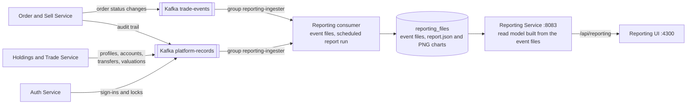
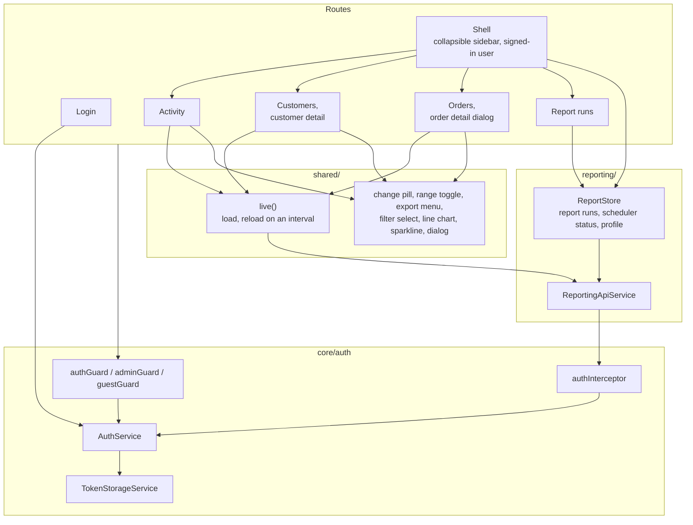
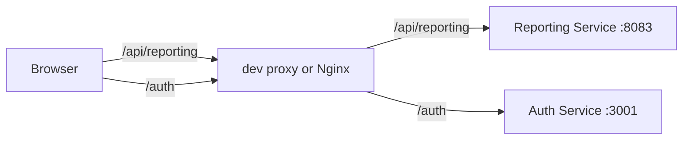
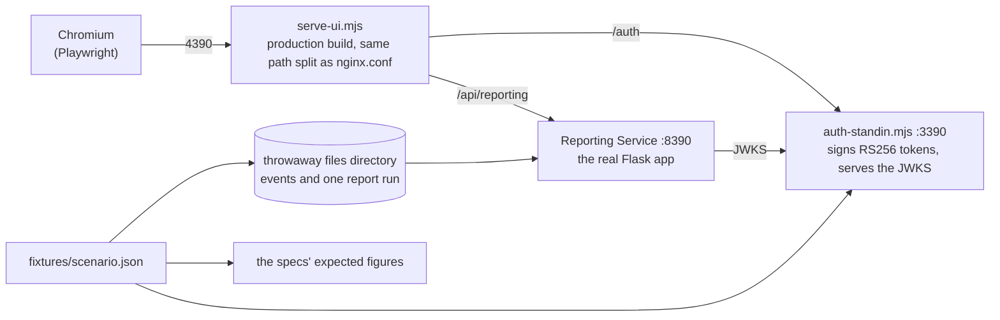

# Reporting UI

Angular 21 single-page app for the analysts who read live report snapshots and the admins who also watch platform activity and support customers. It presents what the [Reporting Service](../reporting-service/README.md) serves: activity, customers and orders from the read model it builds out of the `trade-events` and `platform-records` Kafka topics, and report runs from `trade-events` snapshots. Nothing it shows is read from the trading database. Standalone components, signals, reactive forms, and OnPush change detection, with no server-side rendering.

- Port 4300, for both `ng serve` and the Compose container
- For analysts and admins only. It signs in against the [Auth Service](../auth-service/README.md) and admits an account only if its token carries the `ANALYST` or `ADMIN` [role](../auth-service/README.md#roles). An admin sees every screen; an analyst sees the report runs and nothing else. It has no registration screen. In development, sign in as `reporting-admin@example.com` / `admin123` or `analyst@example.com` / `analyst123`.
- Read only. Nothing in it changes an account or an order.

| Route | Open to | Screen |
| --- | --- | --- |
| `/login` | anyone not signed in as an analyst or admin | Sign in |
| `/` | admin | Activity: a range toggle, five headline figures against the prior period, notional traded over time, orders by status, activity by client segment, the newest events, most traded symbols |
| `/customers` | admin | Customers: every trader with status, accounts, cash, portfolio, failed sign-ins and last activity; search and filters. Analysts and admins are not customers and are not listed |
| `/customers/:userId` | admin | One customer: profile, sign-in security, balances, and their orders and cash transfers, with the same search and filters as Orders |
| `/orders` | admin | Orders: every order, and the deposits and withdrawals among them, with search and filters; an order's row opens the order with its execution, ledger impact, audit trail and references. Each audit entry shows the price the order stood at when it was recorded: the price it asked for, and the fill price on the entry that records the fill |
| `/runs` | analyst, admin | Report runs: the latest run as a dashboard over today, 7, 30 or 90 days, or all time, as Activity offers. Five headline figures, trades per day, and traded value by client segment, by symbol and per account. Each card offers its chart as a PNG download for the range on screen |

An analyst who asks for an admin's screen, by a link or by signing in, is taken to `/runs`, and the sidebar offers an analyst only that entry.

Every figure on screen comes from the Reporting Service. Nothing is demo data. Times are shown in the viewer's time zone, and a range such as Today is the viewer's own day. The days inside a report run are UTC days, as the report job buckets them.

Activity opens on the last seven days. The range chosen there is kept in this browser's `localStorage`, so leaving for another screen, reloading or signing in again comes back to it; a browser that refuses storage opens on seven days each time.

## Business requirements covered

The reporting requirements of the LEAP business requirements specification, and where each is met:

| Requirement | Where |
| --- | --- |
| BR-16, by instrument | Most traded on Activity; traded value by symbol in a report run |
| BR-16, by period | The Today, 7D, 30D, 90D and All ranges on Activity, each figure but all time's against the period before; trades per day in a report run |
| BR-16, by client segment | Client segments on Activity; traded value by client segment in a report run. A segment is a trader's level, the only classification of clients the product keeps |
| BR-16, without competing with live trading | Every screen is answered from Kafka: the Reporting Service has no connection to the trading database. Report runs are served from live `trade-events` snapshots; Activity, Customers and Orders from a read model of `trade-events` and `platform-records`; see [How the data reaches the screen](#how-the-data-reaches-the-screen) |
| BR-17, trading volumes, most active instruments, client activity trends | On Activity: Notional traded, Most traded, and Active traders against the prior period beside Client segments |
| Section 9.3, internal access limited to what a role requires | An analyst sees the report runs only; the screens that show individual customers are an admin's. See [Who sees what](#who-sees-what) |

## How the data reaches the screen



The UI never talks to Kafka or the database, and neither it nor the Reporting Service reads the database at all. Two kinds of data reach it, both through the Reporting Service:

| Screen | Source | Endpoint | Kept fresh by |
| --- | --- | --- | --- |
| Activity | Read model | `GET /api/reporting/activity?range=&tzOffset=` | Reading again every 15 seconds, and when the range changes |
| Customers | Read model | `GET /api/reporting/customers` | Reading again every 30 seconds |
| One customer, with their orders and transfers | Read model | `GET /api/reporting/customers/{userId}` | Reading again every 30 seconds |
| Orders and cash transfers | Read model | `GET /api/reporting/orders` | Reading again every 30 seconds |
| One order | Read model | `GET /api/reporting/orders/{orderId}` | Read when the order is opened |
| Report runs | `trade-events` files | `GET /api/reporting/runs`, `GET /api/reporting/runs/latest?range=&tzOffset=`, `GET /api/reporting/scheduler/status` | Reloading the latest snapshot every 5 seconds, plus reloading when the range changes and when scheduler metadata says run archives changed |
| A chart PNG of a run | `trade-events` files | `GET /api/reporting/runs/{runId}/files/{name}`, fetched as a blob because a link cannot send the bearer token | Fetched when its download is asked for |
| Signed-in user's name and trader level | Read model | `GET /api/reporting/profile`; a sign-in without a trading profile (404) shows its email instead | Read once |

The read model is the Reporting Service's own tables, built from the `trade-events` and `platform-records` messages its consumer stored; see [the Reporting Service](../reporting-service/README.md#the-read-model). A message reaches the screens on their next poll interval.

A polling cycle that fails leaves the last good data on screen. Every screen shows what was published while a Kafka broker was running, and what [republish_history.py](../../db/README.md#reporting-feed-tools) published from the database afterwards.

## Architecture



`ReportStore` is provided by the shell component, so it exists only while a signed-in screen is shown and its polling stops on sign-out. Each console screen owns its data through `live()`, which stops with the screen.

### Request routing



Both backends are called on the UI's own origin, so neither needs a CORS entry for port 4300. The split is configured twice: [proxy.conf.json](proxy.conf.json) for `ng serve` and [nginx.conf](nginx.conf) for the local container image. Add a new backend path to both. The Client UI does the same for `/auth`.

Token handling matches the Client UI: the interceptor adds the bearer token to `/api/reporting` calls, refreshes an expired access token through `POST /auth/refresh`, retries once after a 401, and sends the user to `/login` when the refresh token is missing or rejected. The session is kept in `localStorage` under its own key, separate from the Client UI's because the two apps are different origins.

### Who sees what

The Reporting Service is what enforces the rules: it answers 403 on the run endpoints to a token with neither the `ANALYST` nor the `ADMIN` role, and on the console endpoints (activity, customers, orders) to a token without `ADMIN`. The UI checks the same claim so that nobody gets a screen that could only show errors:

| Moment | An account that is neither an analyst nor an admin | An analyst |
| --- | --- | --- |
| Sign-in | The credentials are accepted by the Auth Service, the UI revokes that session at once, keeps no token, and says the account has no access to reporting | Signed in and taken to Report runs |
| Opening a screen with a stored session | `authGuard` signs it out and returns to `/login` with the same message | `adminGuard` takes it from Activity, Customers or Orders to Report runs |
| A 403 from the Reporting Service, for example after a refresh issued a token for a changed role | The interceptor signs it out and returns to `/login` with the same message | The same: the guards keep an analyst off the console, so a 403 means the role changed |

A role change takes effect at the account's next sign-in or token refresh. See [roles](../auth-service/README.md#roles) for how an account becomes an analyst or an admin.

## Design system

The screens reproduce the TradingSeason design system's reporting console: the sidebar shell, Activity, Customers, the customer page, Orders and the order dialog, with the kit's layout, spacing, type and copy. The design system export itself is not checked in.

The tokens are declared in [src/styles.css](src/styles.css) with the same values as the Client UI's dark theme, and Tailwind v4 maps them to utilities. Text takes the font's own line height, as the kit does. The kit's components are ported once, in [src/app/shared](src/app/shared):

| Kit component | Here |
| --- | --- |
| ChangePill, status tags | [change-pill.component.ts](src/app/shared/change-pill.component.ts) |
| TimeframeToggle | [timeframe-toggle.component.ts](src/app/shared/timeframe-toggle.component.ts) |
| HeaderDropdown with the export menu | [export-menu.component.ts](src/app/shared/export-menu.component.ts): CSV of the rows on screen, or PDF through the print dialog; see [Export PDF](#export-pdf). On Activity the CSV is every order placed in the chosen range, fetched from the Reporting Service when it is asked for, not the status split on screen |
| Select with a caption | [filter-select.component.ts](src/app/shared/filter-select.component.ts) |
| PriceChart | [line-chart.component.ts](src/app/shared/line-chart.component.ts) |
| Sparkline | [sparkline.component.ts](src/app/shared/sparkline.component.ts) |
| Dialog | [dialog.component.ts](src/app/shared/dialog.component.ts) |
| Orders table with its search and filter row | [order-table.component.ts](src/app/orders/order-table.component.ts) inside [order-browser.component.ts](src/app/orders/order-browser.component.ts), shared by Orders and the customer page |
| DashCard, DashLabel, DashLink, Button, Input, table head and rows | Classes in [src/styles.css](src/styles.css): `dash-card`, `net-worth-card`, `dash-label`, `dash-link`, `ghost-button`, `ds-control`, `dash-table-head`, `row-button` |
| None: the kit draws no loading state | [skeleton.component.ts](src/app/shared/skeleton.component.ts): the headline figures, a card with a chart or a breakdown, labelled values, and a searchable table, built from the `skeleton` class in [src/styles.css](src/styles.css) |

From 1024px wide a screen fills the window and its lists scroll inside their cards, with a bottom fade and no scrollbar, as the kit draws it. From 1280px wide Activity does so down to a window 616px high, so it fits a short wide display such as 1920x828 with the browser's own bars: its chart row, with the chart and the two splits side by side, takes four ninths of the room under the headline figures and never less than the four statuses need, and the two lists take the rest. Between 1024px and 1279px the two splits stack beside the chart so that it keeps its width, and the screen fills a window from 1032px high. Narrower, or on a shorter window, the page scrolls.

Report runs fills the window from 1280px wide, down to the same 616px: the row with Trades per day and the client segments takes five ninths of the room under the headline figures and the row with symbols and accounts the rest, the chart grows with its card, and each breakdown scrolls inside its own. Below 1280px its cards stack and the page scrolls.

While a screen's first load is in flight it shows placeholders in its own layout: Activity and Report runs their headline figures and cards, Customers and Orders their search, filters and table, the customer page its heading, three cards and orders, and the order dialog its sections. Each is laid out on the same grid as the loaded screen, so on a window the screen fills nothing moves when the data arrives. The blocks pulse, stop under `prefers-reduced-motion`, and are hidden from assistive technology, which is told what is loading by a visually hidden status. A load that fails shows the error and its retry instead, and a refresh keeps the data already on screen. The Client UI declares the same `skeleton` class for its own [loading states](../client-ui/README.md#loading-states); keep the two alike.

From 768px wide the sidebar stands beside the screen and can be collapsed to 60px with the button beside the logo: the logo mark, the navigation icons, the button itself and log out stay, and the names remain as tooltips and for assistive technology. The choice is kept in this browser's `localStorage`. Narrower, the sidebar is a bar across the top and does not collapse.

The kit is a proposal drawn on sample data. Where the product has no such data, or the screen must stay read only, the app departs from it:

| Kit | Here | Why |
| --- | --- | --- |
| "Unlock now" on a locked customer, "Email customer" | Left out; the lock banner says when the account unlocks | Reporting only reads |
| Statuses FILLED, PENDING, REJECTED, CANCELLED, and customer status SUSPENDED | FILLED, PENDING, ACCEPTED, REJECTED; ACTIVE and LOCKED | These are the statuses the product has |
| Order execution: bid and ask at submit, spread, market price now, session | Indicative price, price buffer, slippage, submitted, resolved, market time | The quote an order executed against is not kept, so it is not published |
| The orders table has a Type column | An Amount column in its place: shares at the fill price | Every order is a market order, so the column said the same on every row |
| The orders table lists orders only | Deposits and withdrawals are rows among the orders: asset Cash, side Deposit or Withdrawal, status Completed, the cash moved under Amount, no order number and nothing to open | A customer's cash movements belong beside their orders when supporting them |
| The order dialog puts References last in the left column, the client reference cut to its cell | References sits under the audit trail, with the client reference shown whole on a row of its own and a copy button | On a short window the references were below the fold, and a cut reference cannot be read or selected |
| The customers screen has a Role filter | No Role filter, and no analysts or admins in the list | Staff are not customers, so every row is a trader |
| The chart's value axis divides the range between the lowest and highest value into four | It rounds to steps of 1, 2, 2.5 or 5 times a power of ten, from zero for notional traded, and a flat series has one label | The even division read $75,542, $56,657, and on a day without a trade ran below zero and out of the card |
| The sidebar is fixed at 232px | It collapses to its icons | Asked for, to give the screens the width |
| "Streaming" beside Live activity | "Live" | The feed is read again every 15 seconds, not streamed |
| Activity opens on Today | It opens on 7D, and afterwards on the range last chosen in this browser | Asked for: Today is mostly zeros until the day's first order |
| The range toggle offers Today, 7D, 30D and 90D | A fifth range, All: all time, from the day of the first order or cash transfer. It has no change pills, and Orders says "since" that day in place of "vs prior period" | Asked for. Nothing comes before all time to compare it with |
| The chart row holds Notional traded and Orders by status | A third card, Client segments: each trader level's notional and its share, traders and orders in the range | The business requirements ask for activity by client segment, which the kit predates |
| Three sidebar entries | A fourth, Report runs, and for an analyst only that one | The Kafka-backed report snapshots are a product requirement the kit predates |
| No way to sign out | A log out button beside the signed-in user | The kit does not draw one |
| No loading state | Placeholders in the screen's layout while its first load is in flight | The kit is drawn on sample data, which is never on its way |
| Most traded shows a price sparkline under "Today" whatever the range | The column is named after the chosen range and plots the symbol's fill prices in it | The label follows what is plotted |

Report runs is not in the kit. It is built from the kit's vocabulary as Activity uses it: the headline tiles, cards, the 6px bars of Orders by status, and filled orders in the gain color with rejected ones in the loss color. Its header carries the range toggle Activity has, with the same five ranges, and it opens on 7D and afterwards on the range last chosen in this browser, which it remembers apart from Activity's. Its figures are drawn in the page from what the service answers for the latest live snapshot over that range: all time is the full snapshot with days in UTC, and a narrower range is the service's cut of that snapshot in the viewer's days, ending when the snapshot was generated. The days of Trades per day are also given to screen readers as a table that names the zone, and the column under the pointer is read out above the chart. The PNG charts for the latest snapshot are rendered by the Reporting Service at download time, in the light theme's surface and colors whatever the theme on screen; a file of a narrower range carries the range in its name. When a run archive is more than a minute late the header says Overdue with the time it was expected, which is how a consumer that is not running shows; an on-time archive shows nothing there.

This app does not use the Client UI's [shared-ui-components](../client-ui/shared-ui-components/README.md). Its own markup is styled directly from the tokens, so that library still has one consumer.

### Export PDF

Export PDF, on every screen, prints the screen through the browser's print dialog, and the print rules in [src/styles.css](src/styles.css) make the printout the desktop screen:

- The page is 1376 by 973 CSS pixels, A4's landscape proportions, so the content is as wide as a laptop window and still fits paper. In print every breakpoint counts as reached, because a width query in print answers for the sheet the browser has in mind and not for that page; the breakpoint variants are redefined in the stylesheet to say so.
- The sidebar, the Export button and the download links are left out. A line at the top, shown only in print, carries the product name, when the export was made and who made it. The Activity range and the filters of Orders and Customers stay, so the document says what it covers.
- Nothing scrolls or clips: every list and table is printed whole, over as many pages as it needs. A card stays on one page; a card that holds a list breaks between its rows.
- The dark theme is kept, and the page margins are covered in the app's background so no frame shows around a page.

In the print dialog choose "Save as PDF". The dialog's own Paper size and Margins are overridden by the page the stylesheet sets. A table that runs over several pages does not repeat its column headings, because the tables are grids and not HTML tables.

## Commands

reporting-ui is an independent npm project with its own lockfile. From the repository root:

```sh
npm --prefix apps/reporting-ui ci
npm --prefix apps/reporting-ui start
npm --prefix apps/reporting-ui run build
npm --prefix apps/reporting-ui test -- --no-watch
npm --prefix apps/reporting-ui run e2e
```

`ng serve` runs on port 4300 and expects the Auth Service on `localhost:3001` and the Reporting Service on `localhost:8083`; [scripts/start-local.ps1](../../scripts/start-local.ps1) starts all three, see [Local processes](../../README.md#local-processes-windows). Use `--no-watch` for the tests; Vitest's `--run` is not supported by the builder.

What the screens show depends on what is running:

| Situation | Activity, Customers and Orders | Report runs |
| --- | --- | --- |
| Reporting Service not reachable | A load error with a retry | A load error with a retry |
| Reporting Service up, consumer never started | Empty: no customers, no orders | "No report runs yet" |
| Consumer running, nothing published yet | Empty, then each sign-in, customer and order as it is published | A report of zeros |
| Customers sign up and trade while the broker and consumer run | All of it, within seconds | Their orders, within seconds |
| History republished from the database | Everything in the database at that moment | The same, once republished |

Messages exist only for what the services did while a Kafka broker was running. What was already in the database, or was written to it by SQL, reaches every screen once [republish_history.py](../../db/README.md#reporting-feed-tools) has published it. [seed_demo_history.py](../../db/README.md#reporting-feed-tools) gives a development database six months of history to republish.

The [Dockerfile](Dockerfile) builds the app and serves it through unprivileged Nginx, with SPA fallback and the two proxies. It is the local stand-in for S3 behind CloudFront, not the deployable artifact: deploy `dist/reporting-ui/browser` to S3 as [Static UIs on S3](../../infrastructure/README.md#static-uis-on-s3) describes. In [Local Compose](../../infrastructure/docker-compose/docker-compose.local.yml) the container starts after `reporting-service` and `auth-service`, because Nginx resolves both upstream names when it starts.

## Tests

`*.spec.ts` beside the code under `src`, on the Angular unit-test builder with Vitest. The run fails below 90 percent on statements, branches, functions, or lines (`coverageThresholds` in [angular.json](angular.json)). Add `--coverage` for the report. Shared test data and DOM helpers live in [src/testing](src/testing) and are excluded from the application build.

[vitest.config.ts](vitest.config.ts) limits the fork pool with Vitest 4's `maxWorkers: 1` and disables file parallelism. Jenkins runs this suite alongside other CPU-heavy stages; keeping test files sequential avoids competing workers causing test timeouts.
### Integration tests

Playwright specs in [e2e](e2e) drive the built app in Chromium against the real Reporting Service, so they check the screens, the service's read model and report run, and its access rules together. Only the two things the service does not itself provide are replaced: Kafka, and the Auth Service.

[playwright.config.ts](playwright.config.ts) allows assertions up to ten seconds while both browser suites share the Jenkins agent. CI still fails on a flaky test that passes only on retry.



- **The service is the real one.** [run_reporting_service.py](e2e/support/run_reporting_service.py) writes every message of [scenario.json](e2e/fixtures/scenario.json) to the topic files through the service's own `EventStore`, using the producers' message shapes from the service's `tests/messages.py`, then makes one report run with the service's own `run_report` (PNG charts included) and serves the app on a throwaway directory. The read model, the console queries and the role checks are not mocked.
- **The Auth Service is a stand-in.** [auth-standin.mjs](e2e/support/auth-standin.mjs) answers `/auth/login`, `/auth/refresh` and `/auth/logout` and publishes a JWKS. It signs access tokens with a key made when it starts, with the claims and no key id the real service uses, so the Reporting Service verifies them with its own JWT checks. Refresh tokens rotate and logout revokes them. It lets a test change an account's roles (`POST /__e2e/roles`), which the real service has no route for.
- **One scenario, two readers.** The service is seeded from the scenario and the specs work their expected figures out from the same file ([scenario.ts](e2e/fixtures/scenario.ts)), so a figure is never typed in twice. Orders are placed between 28 hours and 125 days back, clear of the edges of the 7, 30 and 90 day ranges and never in Today, so the suite gives the same answers whenever it runs. Browsers run in UTC.
- **What is covered.** [sign-in.spec.ts](e2e/sign-in.spec.ts): the sign-in form, both roles, refusals, the no-access turn-away, sign-out and revocation. [access-control.spec.ts](e2e/access-control.spec.ts): each endpoint against each role, a token signed by another key, an expired token, read-only and input checks, and the screens' own handling of the refresh path and of a role change. [activity.spec.ts](e2e/activity.spec.ts), [customers.spec.ts](e2e/customers.spec.ts), [orders.spec.ts](e2e/orders.spec.ts) and [report-runs.spec.ts](e2e/report-runs.spec.ts): every figure, split, filter, sort, export and chart download of their screen, and its error and retry states. [shell.spec.ts](e2e/shell.spec.ts): navigation, the collapsible sidebar and the narrow layout.
- **Run them** from the repository root: `npm --prefix apps/reporting-ui run e2e`. It needs Chromium (`npx --prefix apps/reporting-ui playwright install chromium`) and the Reporting Service's Python requirements. The suite uses `apps/reporting-service/venv` when there is one, else `python` on the path; `E2E_PYTHON` names another interpreter. It builds the app first; `E2E_SKIP_BUILD=1` reuses the last build (and fails if there is none; Jenkins sets it after the Build UI Bundles stage), and `E2E_REUSE_SERVERS=1` reuses processes already listening on 4390, 8390 and 3390. Ports of its own keep a running development stack out of it. Reports are written to `reports/playwright`.
- **Changing the service or a screen.** A new field in a published message, a new endpoint or a new role rule means extending the scenario and the specs with it. The scenario file's own `comment` says what the times must keep clear of.

In the [Jenkins pipeline](../../infrastructure/README.md#jenkins) the suite runs in the End-to-End Tests stage, in parallel with the Client UI's, in the same Playwright image but its own container. That image carries Debian's Python 3.11 as well as Chromium; the stage makes a venv from the Reporting Service's `requirements.txt` and sets `E2E_PYTHON` to it. Neither suite stops the other, and the stage fails if either does. Both apps must resolve the same `@playwright/test` version, since the image holds browsers for one; the stage stops with a message if they differ. The service itself is built for Python 3.14, and the suite has been run on 3.11 and 3.14.

## Known limitations

- The Orders screen shows the newest 500 orders and the newest 500 transfers; the count beside the filters is of those rows. A customer's page shows their newest 1000 of each.
- A figure on Activity has no change pill when the period before the range has nothing to compare with, which is always so for all time. Today is mostly zeros until the day's first order.
- A client segment is the level a trader holds now. The level a trader held when an order was placed is not kept, so a promoted trader takes their earlier orders into the new segment.
- Activity, Customers and Orders are as current as the topics. A customer's portfolio value can be up to 15 minutes old, because scheduled valuations are published at most that often; everything else is on screen at the next refresh.
- An analyst's "Orders per account" card names each account only, never its trader; no card on a report run names a client. The admin console still shows names.
- A transfer row opens nothing: the service has no endpoint for a single cash transaction.
- The Activity ranges are fixed at today, 7, 30 and 90 days, and all time; there is no custom range. All time plots a point per day for a history of up to 366 days. Beyond that a point covers several days and is labelled with the day it starts.
- The service keeps only the newest scheduled run file on disk. Report runs shows a live latest snapshot over the chosen range and does not list earlier runs.
- Report runs counts an order in a range by when it resolved and Activity by when it was placed, so the two screens can differ by the newest orders. Today is a single column of Trades per day, where Activity plots it by the hour.
- Trades per day plots the days that have a resolved order, side by side. A day without one is left out, not drawn as a gap.
- Users are not signed out for inactivity, unlike the Client UI.

Order detail includes execution conditions, submission reference quote, trigger time and outstanding reservations. Order filters include CANCELLED. These values come from the Reporting Service contract and Kafka projection.
